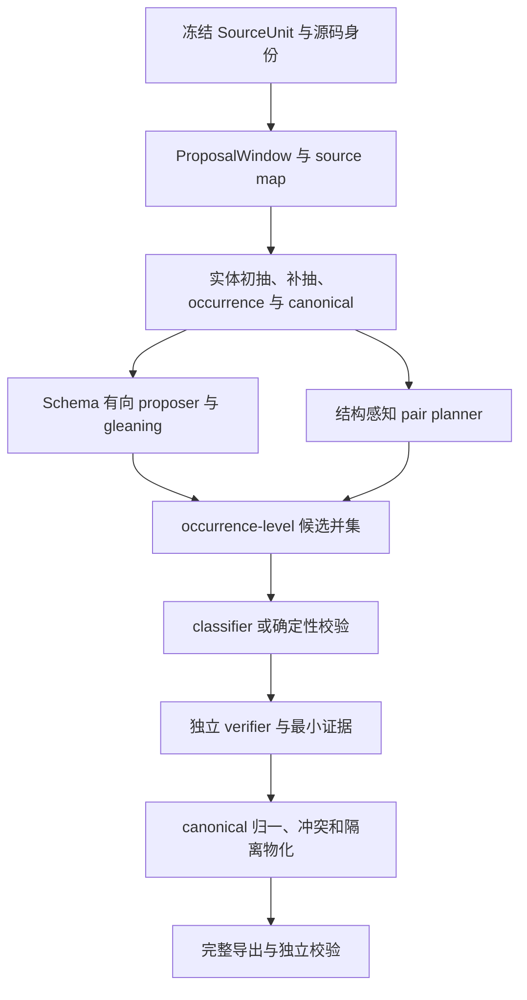

# Knowledge Forge Enhanced / Shadow v2 全量整改执行计划

> 版本：RAGFlow 高召回前端 + Knowledge-Forge 可信后端，重生成版 v2  
> 适用仓库：`zjx2024/Knowledge-Forge`  
> 目标分支：`fix/shadow-relation-quality-v2`  
> 范围：只修改 Enhanced / Shadow v2，不改变 Stable

## 0. 交给 Codex 的总命令

将本文件完整交给 Codex，并附上下面这段命令：

> 完整阅读并严格执行本文件。先锁定远端目标分支的实际 `BASE_SHA`，核对当前工作树与授权目标一致；然后从 P0 开始，每阶段先建立能在旧实现上复现缺陷的失败测试，再实现、运行 targeted tests、数据库集成测试、前序回归和自审。阶段门禁通过后自动进入下一阶段，不等待逐阶段确认，直到达到当前权限和环境允许的最高完成状态。只允许修改 Enhanced / Shadow v2；不得改变 Stable，不得自动 commit、push、开 PR、合并、部署、发布或激活。遇到本文件列出的暂停条件时停止并报告，不得自行扩大权限或修改范围。

本任务是代码实现、迁移、测试、真实运行、质量评估和交付任务，不是只输出分析建议。

## 1. 最终目标

完成后，Enhanced / Shadow v2 必须具备以下能力：

1. 从 PDF、表格、列表和普通段落中保留可回溯的结构与 source map。
2. 分离实体 observation、mention、appearance、physical occurrence、canonical、alias、type assertion 和 merge/split。
3. 实体抽取、噪声过滤、类型判断与跨 Chunk 归一分别可评估，不再用“实体总数”代替质量。
4. 使用 Schema 引导的直接有向关系 proposer，从较大结构窗口直接提出关系 hypothesis。
5. 在合法首轮抽取后执行最多两轮 relation-only gleaning，补抽遗漏而不重复已有关系。
6. 将 proposer hypothesis 与结构感知 pair planner 候选取并集，避免距离过滤和预算截断提前丢失真实关系。
7. classifier、确定性校验和独立 verifier 各司其职；任何模型失败、空响应或协议错误都不能伪造成业务负例。
8. 所有正关系保留精确 evidence；表格证据保留 header→row→cell 路径；指代关系保留 antecedent 和 coreference 路径。
9. 所有调用、重试、失败、修复、候选、验证、归一和物化均可审计、可重算、可复现。
10. Enhanced 结果只能写入隔离 namespace；正式实体、正式关系、正式向量、正式图、Stable policy 和 activation 均保持不变。

本任务借鉴 RAGFlow 的两项思路：

- 借鉴 `structure_graph` 的“实体先行、Schema 约束、直接关系提议”。
- 借鉴 Light GraphRAG 的“合法首轮后继续补抽遗漏”。

不得照搬 RAGFlow 的以下宽松行为：

- 不得输出无谓词、无方向的通用无向边作为正式事实。
- 不得用自由文本端点绕过 occurrence ID。
- 不得缺少精确 evidence。
- 不得由 proposer 直接物化。
- 不得因为 JSON 能修复就跳过语义契约校验。
- 不得因为关系数量增加就声称质量提升。

## 2. 已知审计锚点与必须重新核对的事实

### 2.1 代码锚点

上一轮可确认的审计锚点为：

```text
commit: f241ee5a0b162e76df62dd537d9fb5a0e63fba47
message: Fail closed on unknown Shadow predicates
```

该提交修复了 parser 层的部分未知 predicate 处理，但 runtime 仍可能把解析失败合成为：

```text
ACCEPTED + OTHER_UNSUPPORTED/SCHEMA_GAP
```

这会造成：

- 失败调用被伪装为成功终态；
- singleton 与 batch 行为不一致；
- 真实 raw response、失败数和 retry 统计失真；
- 没有 pending 的 run 被错误理解为 ready；
- 未知 predicate 不落事实，但失败运行仍可能“审计通过”。

执行本计划时，不得假定远端仍停留在 `f241ee5`。必须以开始执行时解析出的远端 SHA 为 `BASE_SHA`。

### 2.2 当前代码中已确认的结构性缺口

开始实现前必须逐项在当前 `BASE_SHA` 上重新确认，已修复项可保留测试并标记通过，未修复项继续整改：

1. `shadow_context.py` 已存在，但关系 runtime 仍主要按线性 Chunk 运行，结构 Context 并未形成主链输入。
2. proposer 的 retry attempt 被同时当成 `pass_no`，成功后立即退出，不是真正的 gleaning。
3. `already_found_keys` 没有形成可验证的补抽闭环。
4. `missing_endpoint_mentions` 只计数，没有完成实体回补和 namespace 重建。
5. proposer 使用全局连续失败熔断，可能跳过同项目后续结构块。
6. proposer proposal 依赖 pair 已经存在于 pair ledger，无法独立补回 planner 未产生的 pair。
7. singleton 协议错误仍可能被合成为 `ACCEPTED/SCHEMA_GAP`。
8. 旧 native pilot 会克隆历史 entity snapshot，不能证明最新实体抽取和归一效果。
9. 历史 artifact 中实体、source map、model calls 和 proposal attempts 存在空导出或口径不一致。
10. 旧运行的 proposer 为 0 proposal，pair planner 又在分类前过滤大量 pair。
11. `lithium chloride` 与 `lithium carbonate` 等错误合并、常见 alias 未合并、噪声节点和关键端点漏抽仍需用 fresh run 复核。
12. 历史 27 条关系中存在大量列表串联、方向反转、同位误判、标题污染、资助/用途错配和表格跨行污染。

### 2.3 不得继续使用旧 artifact 证明新代码质量

历史目录只能作为失败回归样本：

```text
artifacts/shadow-v2/project-13/2026-07-28-native-v2-run-4d19d9c1
```

最终质量结论必须来自：

- 当前候选源码；
- fresh entity namespace；
- fresh relation run；
- 固定输入文档与 source hash；
- 固定 Schema、Prompt、parser、policy、模型 digest 和解码参数；
- 完整 artifact bundle；
- 独立 bundle validator；
- 人工 Gold。

旧 artifact 不得就地覆盖或修改。

## 3. 候选源码身份与工作树规则

旧计划把未提交修改后的运行仍称为绑定 `TARGET_SHA`，这是错误的。本计划必须使用以下身份：

```text
BASE_SHA            开始修改前的远端不可变基线
WORKTREE_DIFF_HASH  相对 BASE_SHA 的完整 tracked/untracked 候选变更摘要
CODE_TREE_HASH      实际参与运行的 Enhanced 源码、Prompt、Schema、迁移和脚本内容摘要
CANDIDATE_SHA       只有用户另行授权并完成 commit 后才存在
```

规则：

1. 未提交修改生成的 artifact 必须绑定 `BASE_SHA + WORKTREE_DIFF_HASH + CODE_TREE_HASH`。
2. 不得把未提交工作树称为 `BASE_SHA` 的运行结果。
3. 本任务禁止自动 commit，因此正常交付时 `CANDIDATE_SHA` 可以为空。
4. `dirty=true` 不阻止本地工程和 pilot 验证，但必须完整冻结 diff 与 code tree。
5. `production_eligible` 必须基于用户另行确认的不可变 candidate commit 或等价不可变归档；本任务不能自行完成该状态。
6. 执行期间若远端分支再次前进，不得自动 reset、rebase 或追新；记录变化并暂停询问用户。

`CANDIDATE_SHA` 只有在该 commit 解包后的候选源码 manifest 与已验证 candidate source archive 按 path、mode、symlink target 和 content hash 完全一致，且重新计算的 `CODE_TREE_HASH` 相等时，才可绑定既有质量结果。只有一个 commit SHA 不构成等价证明；不一致时必须在该 commit 上 fresh 重跑。

候选摘要不得只对 `git diff` 求 hash，因为 `git diff` 不包含未跟踪的新文件。必须生成并保存规范化候选清单：

```text
relative_path
tracked/untracked
file_size
sha256
runtime_role
```

其中：

- 所有候选身份在模型/数据库运行前的单一 `identity_cutoff` 冻结；
- `initial_worktree_snapshot_hash` 记录 P0 开始时用户已有工作树；
- `WORKTREE_DIFF_HASH` 覆盖相对 `BASE_SHA` 的 canonical binary tracked patch，以及全部非忽略、任务相关 untracked 文件的 path、mode、symlink target、bytes 和 SHA-256；
- `CODE_TREE_HASH` 是不可变 candidate source archive 的 SHA-256；归档覆盖实际 checkout 中所有可能参与运行的项目源码、共享依赖模块、Prompt、Schema、migration、runner、配置和依赖锁文件；
- `runtime_env_hash` 覆盖 Python 版本、已安装依赖、关键原生解析工具或镜像 digest，以及非敏感运行配置；
- artifact 中同时保存候选清单本身，使两个摘要可以离线重算；
- 同时导出 canonical patch、untracked manifest、candidate source manifest 和不可变 candidate source archive，不能只保存摘要；
- `artifacts/`、测试缓存、日志和进度文件只能作为显式 generated-output 排除项，不得进入 candidate source archive；
- 生成输出后允许工作树状态变化，但 `identity_cutoff` 后任何源码、Prompt、Schema、migration、配置或依赖锁文件变化，当前 run 必须进入 `STALE` 并 fresh 重跑；
- 与任务无关但已存在的用户文件不得被偷偷纳入或覆盖，应在 manifest 中单独列为 excluded working-tree state；
- 运行前验证实际导入的 `knowledge_forge` 模块路径位于当前 `REPO_ROOT`，记录关键模块 resolved `__file__`，不得从 `repo_snapshot`、其他 checkout 或全局安装包加载项目代码。

建议在 artifact manifest 中保存：

```json
{
  "base_sha": "...",
  "worktree_dirty": true,
  "worktree_diff_hash": "...",
  "code_tree_hash": "...",
  "runtime_env_hash": "...",
  "identity_cutoff_at": "...",
  "candidate_sha": null
}
```

## 4. 严格修改边界

### 4.1 可直接修改的 Enhanced / Shadow v2 专属模块

在确认调用方后，可直接修改：

- `knowledge_forge/relation_shadow_v2.py`
- `knowledge_forge/relation_shadow_runtime.py`
- `knowledge_forge/entity_shadow.py`
- `knowledge_forge/shadow_context.py`
- `knowledge_forge/shadow_schema_overlay.py`
- Enhanced / Shadow v2 专属 artifact、evaluator 和 release gate 模块
- `scripts/run_shadow_v2_native_pilot.py`
- `scripts/freeze_shadow_v2_pilot.py`
- `scripts/prepare_shadow_v2_pilot.py`
- `scripts/export_shadow_v2_evaluation_bundle.py`
- Shadow v2 专属测试与 fixture

可按仓库风格新增：

- `knowledge_forge/shadow_entity_extraction.py`
- `knowledge_forge/shadow_relation_proposer.py`
- `knowledge_forge/shadow_artifact_validator.py`
- `scripts/validate_shadow_v2_bundle.py`
- `scripts/fingerprint_shadow_candidate.py`
- 对应测试文件

### 4.2 默认视为共享代码，只允许薄适配

除非通过 `rg` 和调用图证明仅服务 Enhanced，否则以下文件按共享代码处理：

- `knowledge_forge/span_entities.py`
- `knowledge_forge/entity_identity.py`
- `knowledge_forge/schema_evolution.py`
- `knowledge_forge/service.py`
- `knowledge_forge/database.py`
- `knowledge_forge/migrations.py`
- `knowledge_forge/config.py`
- `knowledge_forge/policy.py`
- `knowledge_forge/quality.py`
- `knowledge_forge/release_gate.py`
- `knowledge_forge/hugegraph_store.py`

共享文件只允许：

- 增加显式 `enhanced_shadow` 分支；
- 增加 Shadow-only 数据库 API、表、列和 migration；
- 增加 Shadow-only 配置；
- 增加 Shadow-only 指标与 artifact 门禁；
- 增加 Enhanced namespace 的隔离图写入；
- 保持默认 Stable 分支、默认值和历史语义不变。

若需要改变共享抽取器行为，优先新建 Enhanced-only wrapper/sidecar，不修改共享实现。

Stable 不变量分两类：

1. Stable-exclusive/protected 文件：byte hash 必须与 `BASE_SHA` 完全相同。
2. 本节允许修改的 shared thin-adapter 文件：不要求 whole-file hash 不变，但必须进入 approved diff allowlist，并证明默认 Stable 调用路径、输入输出 fixture、正式数据库计数、正式图、默认查询、active policy 和 activation 与基线一致。

任何不属于 Shadow-only 文件或 approved shared-adapter allowlist 的 diff 都必须失败关闭。

### 4.3 Stable 禁区

不得修改以下行为：

- `KnowledgeForgeService._ingest_document()` 的 Stable 正式链；
- `SchemaEvolutionService.extract_chunk()`；
- Stable `_sanitize_extraction()`；
- Stable `_relation_candidates()`；
- Stable `_needs_gleaning()`；
- Stable `_verify_relations()`；
- Stable `_review_relation_batch()`；
- Stable relation decision / failure 路径；
- `EntityResolver` 与正式 canonical resolution；
- `VersionedRelationPipeline` 的 Stable 行为；
- 旧 P1 shadow 的既有语义；
- `relation_verification.py` 的 Stable verifier；
- 正式 entity/relation/vector 表写入；
- Stable graph generation、HugeGraph 正式同步和默认查询；
- `BASE_SCHEMA`；
- `CONTROL_POLICY_SET`；
- 已存在 migration 的内容和 checksum；
- production approval、activation 和 active policy。

必须保留或新增 tripwire：

```text
Enhanced → Stable extractor/classifier/verifier calls = 0
Enhanced → formal entity/relation/vector writes = 0
Enhanced → formal graph writes = 0
Enhanced → activation = 0
Stable   → Enhanced-only calls = 0
```

## 5. 目标架构



角色必须固定：

- 实体 extractor：负责找 mention，不负责关系发布。
- proposer：直接产生有向 hypothesis，负责高召回，不负责发布。
- pair planner：补充 proposer 未覆盖的结构候选。
- classifier：处理所有 planner-admitted pair opportunity；不得替代 verifier。若同一 pair 已有 proposer hypothesis，仍可分类以发现其他 predicate。
- deterministic validator：验证端点、Schema、方向、类型、span 和 qualifier。
- independent verifier：只判断一个具体有向 hypothesis 是否被证据支持。
- normalizer：在验证后执行 canonical 归一、inverse/symmetric 处理和冲突聚合。
- materializer：只写 Enhanced 隔离 namespace。

## 6. 核心数据契约

### 6.1 结构的三层分离

不得继续让一个 Chunk 同时承担大上下文、表格结构和最小证据。

#### SourceUnit

代表原始结构：

```json
{
  "source_unit_id": "...",
  "document_id": 1,
  "revision_id": "...",
  "kind": "paragraph|list|table|caption",
  "page": 12,
  "section_path": ["..."],
  "source_hash": "...",
  "structure_quality": "structured|degraded|quarantined"
}
```

#### ProposalWindow

代表给 proposer 的较大语义窗口：

```json
{
  "proposal_window_id": "...",
  "source_unit_ids": ["..."],
  "context_kind": "paragraph_window|list_window|table_row_window",
  "rendered_text": "...",
  "rendered_hash": "...",
  "token_count": 0,
  "structure": {},
  "source_map": []
}
```

要求：

- 足够大，保留直接提议关系的召回优势；
- 不能静默截断；
- 必须在调用前做 token 预算；
- 超限时按结构边界拆分；
- 相邻窗口可重叠，但 physical occurrence 不能重复。

#### EvidenceRef

代表最小支持证据：

```json
{
  "evidence_ref_id": "...",
  "proposal_window_id": "...",
  "rendered_spans": [[10, 34]],
  "source_anchors": [],
  "table_path": {
    "table_id": "...",
    "header_cells": ["..."],
    "row_id": "...",
    "value_cells": ["..."]
  },
  "coreference_path": null
}
```

正关系需要 supporting evidence。业务负例只保存：

```text
inspected_context_refs + reason_code
```

不得用完整 pair context 伪装成负例或正例的精确证据。

### 6.2 实体分层

必须区分：

```text
EntityObservation
  → Mention
  → Appearance
  → PhysicalOccurrence
  → TypeAssertion
  → CanonicalAssignment
  → AliasAssertion
  → Merge/Split/Redirect
```

最小字段：

```json
{
  "mention_id": "...",
  "surface": "Eagle Mine",
  "normalized_surface": "eagle mine",
  "entity_type": "Facility",
  "source_anchor": {},
  "rendered_span": [0, 10],
  "physical_occurrence_id": "...",
  "extractor_version": "...",
  "decision": "accepted|quarantined|rejected",
  "reason_codes": []
}
```

身份规则：

- mention ID 不得因预测 type 改变而变化；
- physical occurrence 由原始文档 anchor 决定，不由 Chunk ID 决定；
- 重叠 Chunk 中同一物理位置只能有一个 occurrence；
- 同一 occurrence 可以保留多个 appearance；
- canonical ID 不得仅由 normalized surface 决定；
- 同名可能是不同实体；
- 别名相似不等于同一实体；
- embedding 只能产生候选，不能直接合并；
- cannot-link 优先于相似度。

### 6.3 RelationProposal

```json
{
  "proposal_id": "...",
  "proposal_window_id": "...",
  "subject_occurrence_id": "...",
  "predicate_id": "produces",
  "object_occurrence_id": "...",
  "direction": "forward",
  "evidence_refs": ["..."],
  "qualifiers": [],
  "pass_no": 0,
  "candidate_source": "direct_proposer",
  "confidence": 0.0
}
```

约束：

- subject/object 必须属于输入 occurrence 集；
- predicate 必须属于当前 Shadow Schema overlay；
- evidence 必须属于当前 ProposalWindow；
- confidence 只能排序，不能决定发布；
- few-shot 示例中的实体不得出现在输出，除非它也真实存在于输入 occurrence 集；
- proposer 不得创建 canonical；
- proposer 不得直接写事实。

### 6.4 模型调用 envelope

proposer、classifier、verifier 使用统一 append-only 调用 envelope：

```json
{
  "call_id": "...",
  "stage": "proposer|classifier|verifier|entity",
  "unit_ids": ["..."],
  "round_no": 0,
  "retry_no": 0,
  "request_payload": {},
  "request_hash": "...",
  "raw_response_text": "...",
  "raw_response_hash": "...",
  "repaired_response_text": null,
  "repaired_response_hash": null,
  "parsed_response": null,
  "status": "ACCEPTED|RECOVERED_LOCAL_REPAIR|RETRYABLE_*|TERMINAL_FAILED",
  "error_type": "",
  "error_message": "",
  "model_name": "...",
  "model_digest": "...",
  "prompt_version": "...",
  "schema_version": "...",
  "parser_version": "...",
  "temperature": 0,
  "seed": null,
  "context_limit": 0,
  "max_output_tokens": 0,
  "token_usage": {},
  "latency_ms": 0
}
```

所有 hash 必须能从导出内容独立重算。

## 7. 持续执行协议

每阶段执行顺序固定：

1. 建立缺陷追踪项。
2. 添加 characterization test 或旧实现上必失败的新测试。
3. 确认失败原因正是目标缺陷。
4. 实现最小完整闭环。
5. 同步实现本阶段需要的 Shadow-only persistence/migration。
6. 运行 targeted tests。
7. 运行 disposable PostgreSQL tests。
8. 运行所有前序阶段回归。
9. 自审调用路径、状态机、幂等、审计、source map、Stable 隔离和 artifact。
10. 更新本地进度记录。
11. 门禁通过后自动进入下一阶段。

建议进度文件：

```text
.codex/work/enhanced-shadow-v2-ragflow-hybrid-progress.md
```

每个缺陷必须形成：

```text
缺陷
→ 旧实现失败测试
→ 修改文件
→ targeted test
→ PostgreSQL test（若适用）
→ artifact/metric 证据
→ 状态
```

禁止：

- 只增加 mock 单元测试而不经过真实生产调用路径；
- 在测试中复制实现逻辑；
- 修改断言以继续接受错误行为；
- 删除失败测试逃避回归；
- 用 skipped 代替 passed；
- 用关系数量代替召回和精度。

## 8. 分阶段实施

## P0：锁定真正基线、边界和 Stable 不变量

### 实现

先只做本地只读发现：

```bash
set -euo pipefail
REPO_ROOT="$(git rev-parse --show-toplevel)"
cd "$REPO_ROOT"
git status --porcelain=v2 --branch
git branch --show-current
git rev-parse --verify 'HEAD^{commit}'
git remote get-url --all origin
rg --files -g 'AGENTS.md' -g '!KnowledgeFiles/**'
```

完整阅读全部适用的 `AGENTS.md` 后，才允许解析远端基线：

```bash
set -euo pipefail
cd "$(git rev-parse --show-toplevel)"

test "$(git branch --show-current)" = "fix/shadow-relation-quality-v2"

ORIGIN_URL="$(git remote get-url origin)"
case "$ORIGIN_URL" in
  https://github.com/zjx2024/Knowledge-Forge|https://github.com/zjx2024/Knowledge-Forge.git|git@github.com:zjx2024/Knowledge-Forge.git) ;;
  *) echo "unexpected origin: $ORIGIN_URL" >&2; exit 2 ;;
esac

git fetch --no-tags origin \
  refs/heads/fix/shadow-relation-quality-v2:refs/remotes/origin/fix/shadow-relation-quality-v2

BASE_SHA="$(git rev-parse --verify \
  'refs/remotes/origin/fix/shadow-relation-quality-v2^{commit}')"
HEAD_SHA="$(git rev-parse --verify 'HEAD^{commit}')"
test "$HEAD_SHA" = "$BASE_SHA" || {
  echo "HEAD does not equal authorized BASE_SHA" >&2
  exit 2
}

git log -1 --format=fuller "$BASE_SHA"
git diff --stat "$BASE_SHA" --
git status --porcelain=v2 --branch
```

然后：

1. 当前分支必须为目标分支，且 `HEAD == BASE_SHA`。
2. 若 origin 不是授权仓库、fetch 失败或 remote ref 不能解析，立即暂停；不得使用旧 remote ref 冒充最新基线。
3. 若存在用户修改，判断是否与本任务重叠；重叠时暂停，不得覆盖。
4. 不得使用未经 SHA 校验的旧 `repo_snapshot` 代替当前分支。
5. 建立文件→调用方→Stable/Enhanced 调用图。
6. 对所有未证明 Shadow-only 的文件默认按共享代码处理。
7. 冻结输入文档、revision、source hash、结构产物和旧 artifact 标签。
8. 记录 Stable-exclusive 文件 hash、共享薄适配 allowlist、关键查询结果、正式表计数、graph generation、active policy 和 activation。
9. 运行当前基线测试并记录已有失败。
10. 建立 P0～P10 缺陷矩阵。

### 门禁

- 当前工作树与授权基线一致。
- 用户修改未被覆盖。
- Stable 不变量已冻结。
- 旧 artifact 被标为历史失败样本。
- `BASE_SHA` 已记录。
- 尚未把未提交候选称为 `BASE_SHA` 运行结果。

## P1：修复调用协议、重试和 run 状态机

### 必修行为

删除或重构任何“协议错误转业务终态”的逻辑，特别是 singleton 路径。

必须满足：

1. 空响应是 `RETRYABLE_EMPTY`，不是 `NO_RELATION`。
2. 非法 JSON 是 `RETRYABLE_PROTOCOL`。
3. JSON repair 只允许修复语法；修复后仍要完整 Schema 校验。
4. 使用 repair 时同时保存 raw 和 repaired 内容，并标记 `RECOVERED_LOCAL_REPAIR`。
5. 未知 pair ID、缺 pair ID、重复 pair ID 是协议错误。
6. 未知 predicate 是协议错误，不是自动 `SCHEMA_GAP`。
7. 相同端点只有在该 predicate metadata 明确 `reflexive=true` 时合法；否则为协议错误。越界 evidence、缺正例 evidence和非法 confidence 也是协议错误。
8. 唯一 unsupported 业务终态统一为 `decision=OTHER_UNSUPPORTED`。Schema 无法表达原文关系时，模型必须显式返回 `reason_code=SCHEMA_GAP`、正确 correlation ID、明确 relation cue、候选端点和 inspected context；不得存在第二个独立 `SCHEMA_GAP` decision 状态。
9. singleton 与 batch 使用相同 parser 和 retry policy。
10. mixed batch 只重试失败成员；不得让合法 sibling 被错误终止。
11. 每次真实调用先写 append-only attempt，再聚合 decision。
12. 达到 `max_attempts` 后写 `TERMINAL_FAILED`，不得合成 `ACCEPTED`。
13. terminal failure 的 run 不得标记 ready、complete 或 eligible。
14. “没有 pending”不等于成功。

run 状态至少区分：

```text
RUNNING
EXECUTION_COMPLETE
COMPLETED_WITH_FAILURES
AUDIT_COMPLETE
REBUILD_REQUIRED
STALE
FAILED
ELIGIBLE
```

`ELIGIBLE` 必须同时满足：

- 执行完整；
- 无 terminal model failure；
- 审计守恒；
- source/evidence 可重建；
- fingerprint 未 stale；
- 质量/发布 policy 允许。

### 必改测试

至少覆盖：

- singleton 未知 predicate；
- batch 一个合法负例 + 一个未知 predicate；
- 空 response；
- 截断 response；
- malformed JSON；
- 可语法修复但语义非法；
- duplicate/missing/unknown pair IDs；
- evidence 越界；
- 同端点 non-reflexive predicate 拒绝、reflexive predicate 允许；
- timeout；
- 最后一次仍失败；
- retry 后成功；
- batch size 1、2、N 的语义一致性；
- attempt no 连续且不重复；
- request/response hash 独立；
- terminal failure 不 ready；
- replay 幂等。

不得继续保留“parser error 被写为 `ACCEPTED/SCHEMA_GAP`”的旧断言。

### 门禁

- 空响应转负例为 0。
- 协议错误转合成 accepted 为 0。
- calls、attempts、retry、failure 和终态可 100% 重算。
- batch size 不改变业务结论。
- terminal failure 不可 eligible。
- Shadow persistence 已通过 disposable PostgreSQL 测试。
- Stable 零变化。

## P2：接通 Enhanced 结构 sidecar

### 实现

扩展并真正接通 `shadow_context.py`：

1. runtime 不再直接把线性 Chunk 当作唯一 proposer 输入。
2. 从冻结 parser/processing payload 构造 SourceUnit。
3. 从 SourceUnit 构造 ProposalWindow。
4. 为每个 ProposalWindow 构造多段 source map。
5. 表格保留 table ID、row ID、cell ID、header path、unit、period、estimated 和 page。
6. 列表保留 governing phrase、list head、item 和层级。
7. 普通段落保留标题路径、句子和 clause anchor。
8. 跨页表格保留重复表头与原始表头的映射。
9. 页眉、页脚、页码、目录标题和重复栏目标题标为结构元数据或噪声，不默认成为实体。
10. ProposalWindow 超 token 时按表格行、列表项、段落边界拆分。
11. 任何截断必须显式失败或拆分，不得静默丢尾部。
12. 历史文档只能降级为 `legacy_chunk_local`，不能冒充结构完整。
13. 表格文档若只能线性化，标记 `quarantined/degraded`，不能通过 production 结构门禁。

### 测试

固定 fixture 至少覆盖：

- 普通段落；
- 标题+段落；
- 列表 governing phrase；
- 相邻列表项不得串联；
- 表格 header→row→cell；
- 相邻国家行不得串联；
- 跨页重复表头；
- 空单元格；
- 年份、单位、估计值；
- 同一 source span 出现在父子 Chunk；
- ProposalWindow 拆分与 source map 往返；
- rendered span 到原始 anchor 的精确映射。

### 门禁

- runtime 实际使用 ProposalWindow，而不是仅测试 sidecar。
- 所有 rendered text 均可映射到 source anchor。
- table/list 结构无法恢复时不会静默通过。
- Stable Chunk 文本、边界和 content hash 不变。
- 新结构契约已同步持久化并通过 PostgreSQL。

## P3：实体 mention 抽取、噪声过滤和端点覆盖

### 实体抽取

建立 Enhanced-only 实体抽取路径：

1. 在 SourceUnit/ProposalWindow 上抽实体。
2. 输出 exact surface、type、rendered span 和 source anchor。
3. 使用统一、版本化 type vocabulary。
4. 保存原始模型调用、raw response、parser 结果和 rejected observation。
5. 不把 type 写入 mention identity。
6. 不因同一 surface 在重叠 Chunk 出现而重复创建 occurrence。
7. 不要求所有大写词、数字串或表头成为实体。
8. 不在生产代码硬编码 USGS、国家、矿物或某份 PDF 的具体字符串。

### 噪声过滤

至少处理：

- 电话；
- 邮箱；
- URL；
- 日期；
- 财政年度；
- 纯金额；
- 纯数量；
- 单位；
- 页码；
- 表头；
- 页眉/页脚；
- 脚注标记；
- 章节标签；
- OCR 残片；
- 只有格式意义的年份后缀。

噪声规则必须结合上下文和类型，不能粗暴删除所有含数字的合法标准、型号或组织名称。

### 端点覆盖

实体阶段执行：

```text
初始实体抽取
→ entity-only targeted gleaning
→ occurrence/type 校验
→ 冻结 occurrence/type snapshot
```

entity-only targeted gleaning 只寻找可能被遗漏的实体 mention，不输出关系事实。

P3 不得提前声称 canonical 已完成；P4 负责 alias/canonical 归一，并在其门禁通过后冻结最终 entity namespace。

若关系 proposer 后续发现 missing endpoint：

1. 必须给出精确 surface、span、source anchor 和预期 type；
2. 不得在当前冻结 namespace 原地创建实体；
3. 当前 relation run 进入 `REBUILD_REQUIRED`；
4. 新建 entity namespace 或新 revision；
5. 完整重跑 P3 与 P4，冻结新的 entity namespace 后再重跑整条 relation run；
6. 同一 source fingerprint 最多自动重建一次，防止死循环。

关键回归必须覆盖类似：

```text
cobalt-bearing nickel concentrate
```

但生产规则不得只识别该字符串。

### 门禁

- 固定审计集 mention exact-span 指标可计算。
- Gold relation endpoint mention recall 在 pilot 审计集为 100%。
- rejected/quarantined 噪声不进入 accepted occurrence/type snapshot。
- 漏失 endpoint 不会被 proposer 直接创建为事实端点。
- mention/observation/rejection ledger 守恒。
- occurrence/type snapshot 已冻结，但尚未冒充最终 canonical namespace。
- Stable extractor 不变。

## P4：physical occurrence、类型、alias 和 canonical 归一

### physical occurrence

physical occurrence key 必须基于：

```text
document/revision
+ page/block/table/cell anchor
+ source-local span
+ source text hash
```

不得依赖：

- Chunk ID；
- 预测 type；
- canonical ID；
- 模型 confidence。

重叠父子 Chunk：

- 同一物理位置只保留一个 occurrence；
- 多个 appearance 全部保留；
- 每个 appearance 可追踪到原 Chunk/ProposalWindow；
- occurrence 级关系候选不得重复计数。

### 类型

类型结果必须保存：

- 原始类型；
- 规范类型；
- type assertion source；
- type policy version；
- confidence；
- 冲突；
- quarantine/review 状态。

必须修复或测试：

- Mine/Facility 不应无条件变成 Organization；
- Law/ProgramOrPolicy 不应变成 Technology；
- Material、Resource、Product、Application 不应随意互换；
- unresolved/generic type 不得获得自动发布优势。

### alias 与 canonical

归一流程：

```text
exact normalized candidate
→ type/identifier/cannot-link gate
→ abbreviation/plural/orthographic candidate
→ contextual or semantic candidate
→ explicit merge decision
→ canonical assignment
```

规则：

1. 同 normalized surface 只产生候选，不保证同一 canonical。
2. homonym 可以保留多个 canonical。
3. acronym/full name 合并必须有证据。
4. singular/plural 可作为强候选，但仍受类型和 cannot-link 约束。
5. embedding 只做候选召回。
6. alias 必须证明同一实体，不是“两个词都在文本中”。
7. 类型冲突、标识符冲突和化学 semantic head 冲突形成 cannot-link。
8. `lithium chloride` 与 `lithium carbonate` 一类 head/modifier 冲突不得合并。
9. must-link 未合并和 cannot-link 误合并分别统计。
10. merge/split/redirect 必须可逆审计。

不得使用：

```text
same normalized surface duplicate canonical == 0
```

作为通用门禁，因为这会逼迫同名实体错误合并。

正确门禁是：

- Gold must-link recall；
- Gold cannot-link violation；
- homonym accuracy；
- pairwise clustering F1；
- B³ precision/recall/F1；
- false merge / false split；
- unambiguous alias duplicate rate。

### 固定回归

至少覆盖：

- chemical head 不同；
- EV / EVs / electric vehicles；
- U.S. / United States；
- plural/singular；
- 大小写；
- 组织缩写；
- 同名不同地点或不同组织；
- 类型冲突；
- identifier 冲突；
- overlap Chunk；
- merge 后 split；
- split 后 redirect；
- 未见字符串 property tests。

### 门禁

- overlap physical occurrence duplicate 为 0。
- appearance provenance 不丢。
- 固定 cannot-link 误合并为 0。
- 已判定噪声不得获得 canonical assignment。
- homonym 不被错误强并。
- pairwise 与 B³ 指标可从原始 assignment 重算。
- entity namespace 冻结后不可原地变异。
- PostgreSQL snapshot/replay 幂等。

## P5：Enhanced Schema overlay 与 Prompt 契约

### Schema overlay

只扩展版本化 Shadow overlay，不改共享 `BASE_SCHEMA`。

每个 predicate 必须包含：

```text
predicate_id
definition
subject_types
object_types
direction
inverse_predicate
symmetric
reflexive
allowed_context_kinds
qualifier_schema
identity_qualifier_keys
polarity/modality policy
positive cues
hard negatives
publish_mode
schema version/hash
```

至少正确表达：

- `is_a`
- `part_of`
- `located_in`
- `produces`
- `uses`
- `used_in`
- `used_as`
- `imports_from`
- `exports_to`
- `processed_in`
- `has_production`
- `has_reserve`
- `has_resource`
- `funded_by`
- `operated_by`
- `published_by`
- `substitutes_for`
- `depends_on`
- `causes`

规则：

1. 新增 predicate 默认 `review_only`。
2. `related_to` 保持 review-only，不自动发布。
3. GenericEntity/wildcard 端点默认 review-only。
4. quantity、unit、period、estimated、currency 优先作为 qualifier，不默认成为实体。
5. 同位解释与 `is_a`、生产与矿山类型、用途与角色必须分开。
6. publish mode 和生产阈值属于产品决策；Codex 不得自行把新 predicate 设为自动发布。

### Prompt 契约

proposer/classifier Prompt 必须真实序列化：

- ProposalWindow；
- occurrence ID；
- surface；
- type；
- source anchor；
- allowed predicate；
- definition；
- 方向；
- qualifier；
- evidence 规则；
- already found keys。

必须添加 request spy tests：

1. 预期 occurrence IDs 全部出现在最终 request payload。
2. allowed predicate、定义和方向全部出现。
3. 禁止的 predicate 不出现。
4. source map/evidence contract 出现。
5. `already_found_keys` 在 gleaning 中按“截至当前轮已发现的精确 hypothesis key 集合”真实传入；首轮合法空结果时允许为空。

必须添加 leakage canary：

- few-shot 示例使用输入中不存在的虚构实体；
- 模型若输出 canary endpoint，parser 必须拒绝；
- 输出端点集合必须是输入 occurrence 集的子集。

这用于避免重复 RAGFlow 新链路中“known nodes 代码准备了但没有真正注入 Prompt”的问题。

### 门禁

- Schema metadata 完整且可 fingerprint。
- Prompt spy tests 通过。
- few-shot endpoint leakage 为 0。
- predicate direction/inverse tests 通过。
- Stable Schema hash 不变。

## P6：Schema 直接 proposer、gleaning 与 missing endpoint 处理

### 单一实现路线

本计划明确采用：

```text
直接有向 hypothesis proposer
→ deterministic validation
→ independent verifier
```

proposer hypothesis 本身不作为 classifier 输入重复判断；但同一 occurrence pair 若也被 planner admitted，仍必须进入 classifier，以发现该 pair 上 proposer 未提出的其他 predicate。

proposer 与 classifier 结果只能按完整 hypothesis key 去重：

```text
ordered subject occurrence
+ predicate
+ ordered object occurrence
+ identity qualifiers
```

不得因为 pair 相同就跳过 classifier 或删除其他 predicate。

### proposer 首轮

对每个 eligible ProposalWindow：

1. 注入完整 occurrence inventory 和 Schema。
2. 直接提出有向 relation hypothesis。
3. 使用 occurrence ID，不使用自由名称。
4. 提供 EvidenceRef。
5. 输出 qualifier。
6. 可以明确返回空 proposals。
7. 空响应、缺响应或非法响应不是“无关系”。

### retry 与 gleaning 必须分离

两层循环：

```text
for pass_no in [0, 1, 2]:
    for retry_no in [0 .. max_attempts-1]:
        尝试得到本 pass 的合法响应
    合法后才决定是否进入下一 glean
```

规则：

- retry 修复同一 pass 的空、截断、协议、timeout 或临时错误；
- pass 0 合法完成后才能进入 glean 1；
- pass 0 后无条件执行一次 glean 1；模型自报 `coverage.complete=true` 不能跳过第一次补抽；
- glean 1/2 只补未出现的 hypothesis；
- 每轮传入截至当前轮的精确 `already_found_keys`，允许空集合；
- “无新增即停止”只适用于 glean 轮，不能因 pass 0 合法返回空 proposals 而跳过第一次补抽；
- glean 1 无新增时停止；glean 1 有新增时执行 glean 2，随后停止；
- `coverage` 只作为诊断字段，不参与 pass 0 早停；
- 最多两轮；
- 不得将 retry_no 当成 pass_no；
- 每个 round 和 retry 独立审计。

### 熔断

不得使用全项目全局熔断跳过后续全部 Context。

熔断至少按：

```text
document
+ context_kind
+ error_class
```

隔离。

每个 eligible ProposalWindow 必须有显式终态：

```text
SUCCESS_WITH_PROPOSALS
SUCCESS_EMPTY
TERMINAL_FAILED_WITH_PLANNER_FALLBACK
TERMINAL_FAILED_NO_FALLBACK
REBUILD_REQUIRED
```

有 terminal failure 的 run 可以用于诊断，但不能 production eligible。

### proposal 与 pair ledger

proposer pair 不得要求事先已被 planner admitted。

若 proposer 输出合法端点：

1. deterministic 生成 unordered occurrence pair identity；
2. 若 ledger 不存在，创建 `DIRECT_PROPOSER` opportunity；
3. 若 ledger 已存在，增加 candidate source；
4. 保留 ProposalWindow 和 EvidenceRef；
5. 不因 canonical 过早折叠不同 occurrence evidence。

### missing endpoint

proposer 只可报告 anchored missing endpoint：

```json
{
  "surface": "...",
  "rendered_span": [0, 10],
  "source_anchor": {},
  "suggested_type": "Material",
  "relation_cue": "..."
}
```

随后执行 P3 的 `REBUILD_REQUIRED` 流程，不能在当前 relation run 动态添实体后继续物化。

### 必测场景

- 首轮成功、glean 1 新增、glean 2 无新增；
- 首轮合法空 proposals、`already_found_keys=[]`、glean 1 找回关系；
- 首轮 retry 后成功，再进入 glean；
- `already_found_keys` 注入；
- duplicated proposal 去重；
- free-name endpoint 拒绝；
- unknown predicate 拒绝；
- few-shot canary 拒绝；
- missing endpoint 触发 rebuild；
- proposer pair 不在 planner 集仍能进入 union；
- 一个文档失败不影响另一文档；
- 表格同行关系；
- 相邻表格行不串联；
- 列表 governing phrase；
- apposition；
- 方向；
- qualifier。

### 门禁

- 不以“至少一个合法 response”作为通过条件。
- 固定审计集报告 proposer-only hypothesis recall。
- 固定 9 条历史明确正关系在候选并集中召回 100%。
- Prompt 注入和 leakage tests 通过。
- retry 与 gleaning 分账。
- proposer 调用与 attempt ledger 100% 对账。
- proposer 不绕过 verifier。

## P7：结构感知 pair planner、候选并集和 classifier

### pair admission

统一句距/字符距不能作为所有结构的硬拒绝条件。

admission 至少考虑：

```text
same_clause
same_sentence
same_paragraph_with_schema_cue
apposition
same_list_item_with_governing_phrase
same_table_row
table_header_to_row
table_header_to_cell
caption_to_table
explicit_coreference_candidate
direct_proposer
```

距离只用于排序或在无结构线索时过滤。

禁止：

- 按 hash 排序截断；
- 因全局 budget 静默丢弃；
- 把表格同行按线性句距拒绝；
- 把相邻列表或相邻表格行自动配对；
- 在 occurrence union 前先 canonical collapse。

### 候选并集

candidate source 可多值：

```text
DIRECT_PROPOSER
TABLE_STRUCTURE
LIST_STRUCTURE
APPOSITION
SAME_CLAUSE
SCHEMA_CUE
DISTANCE_FALLBACK
COREFERENCE
```

对同一 occurrence pair：

- 合并 sources；
- 保留各自 context/evidence；
- proposer hypothesis 直接进入 validator；
- 只要 pair 被 planner admitted 就进入 classifier，即使同一 pair 已有 proposer hypothesis；
- proposer hypothesis 本身不作为 classifier item 重复判断；
- proposer/classifier 输出按完整 hypothesis key 去重，不能按 pair 去重。

### budget

优先级：

1. direct proposer；
2. Gold-independent 的显式表格/列表/语法结构；
3. 强 Schema cue；
4. 近距离候选；
5. 弱回退。

所有 deferred 候选必须有显式状态和原因。

release gate：

- critical/table Gold pair 不得 deferred；
- Gold positive 不得因 budget 静默消失；
- hash truncation 为 0。

### classifier

classifier 判断一个 planner-admitted occurrence pair，可输出该 pair 上 0～N 个具体 predicate hypothesis：

- `HYPOTHESES`
- `NO_RELATION`
- `OTHER_UNSUPPORTED`

要求：

- 每个 pair 有正确 correlation ID；
- 可输出 0～N 个具体 hypothesis；
- unknown predicate 是协议错误；
- `NO_RELATION` 必须显式返回 reason code 和 inspected context；
- `OTHER_UNSUPPORTED` 是唯一 unsupported 业务 decision；Schema gap 使用固定 `reason_code=SCHEMA_GAP` payload，模型自造未知 predicate 始终是协议错误；
- 不要求负例伪造 supporting evidence；
- classifier confidence 不传给 verifier；
- classifier 不能替代 verifier；
- batch size 不改变结果。

### 受控消融

在相同 entity snapshot、Schema、模型 digest、Prompt 和输入上运行：

```text
planner-only
proposer-only
proposer ∪ planner
```

分别报告：

- occurrence pair recall；
- hypothesis recall；
- predicate/direction recall；
- 调用、tokens、延迟；
- 错误来源；
- deferred；
- terminal failure。

### 门禁

- 固定审计集 union candidate recall 达标。
- 9 条历史明确正关系候选召回 100%。
- proposer-only、planner-only、union 分母一致。
- 距离过滤不再删除结构同行真实关系。
- classifier 空响应不变负例。
- budget/deferred 全部可审计。

## P8：确定性校验、独立 verifier、证据与语义门禁

### deterministic validation

验证：

- subject/object occurrence 存在；
- subject/object 相同时，仅 predicate metadata 的 `reflexive=true` 可通过；否则拒绝；
- predicate 在 Schema；
- 方向有效；
- subject/object type 兼容；
- context kind 允许；
- EvidenceRef 属于输入；
- span/source map 可重建；
- qualifier 类型、单位和 period 合法；
- polarity/modality 允许；
- fingerprint 一致。

### independent verifier

verifier 输入只包含：

- ordered triple；
- Schema definition/direction；
- 最小候选证据；
- 必要结构路径；
- 必要 coreference 路径。

不得传入：

- proposer/classifier confidence；
- proposer/classifier verdict；
- “模型已经认为正确”的提示；
- 待验证 hypothesis 的生成理由。

verifier 输出：

```text
SUPPORTED
CONTRADICTED
INSUFFICIENT_EVIDENCE
RETRYABLE_FAILED
```

SUPPORTED 必须同时给出：

- validated EvidenceRef；
- subject/object mapping；
- direction；
- polarity/modality；
- qualifier support；
- 简洁 reason code。

### evidence

普通文本：

- 尽量使用最小 clause；
- evidence 可以是多个非连续 span；
- 每个 span 可映射到原文。

表格：

- header、row label、value cell 和单位共同构成证据；
- 不能只截取线性全文；
- 邻行/邻列不得污染。

指代：

允许：

```text
antecedent span
+ pronoun/relation clause
+ coreference edge
```

但必须：

- 单独保存 coreference source；
- 独立验证；
- coreference 不确定时 review/insufficient；
- 不得仅靠最近实体启发式自动发布。

### 固定 hard negatives

至少覆盖：

- 列表相邻项；
- 表格相邻国家行；
- 表头与数值错列；
- 用途方向反转；
- 生产者与矿山类型同位；
- 法律/资助误判为 uses/produces；
- 标题/页眉误判 part_of；
- publication/publisher 方向；
- material `used_as` 与 `used_in`；
- negation；
- hypothetical/modality；
- development/exploration 误判 production；
- pronoun 错接；
- 金额和单位实体化；
- 跨句无证据共现。

历史人工审计回归：

- 9 条明确正确：保持候选并以正确 predicate/direction 通过。
- 17 条明确错误：旧形式不得 eligible；若修正，必须形成新 hypothesis 并重新验证。
- 1 条边界关系：保持 review/uncertain，不自动发布。

### normalizer 与 conflict

只在 verifier 后执行：

- canonical endpoint 映射；
- inverse canonical orientation；
- symmetric endpoint sorting；
- qualifier-aware identity；
- 多证据聚合；
- contradiction；
- temporal/period distinction；
- conflict；
- review-only。

不得因 canonical 合并而丢失 occurrence evidence。

### 门禁

- 所有 eligible fact 都有独立 verifier。
- 正 evidence/source map 重建率 100%。
- 负例不使用 full context 伪造 supporting evidence。
- 17 条历史错误旧形式 eligible 为 0。
- 边界关系自动发布为 0。
- verifier terminal failure 不 eligible。
- qualifier 和 direction regression 通过。

## P9：持久化、fingerprint、完整导出与独立 bundle validator

### migration

每阶段新增数据契约时同步增加 Shadow-only additive migration。

规则：

- 新 migration 使用当前未占用编号；
- 不改写既有 migration；
- migration 幂等；
- 升级/回放可验证；
- downgrade 若仓库无此机制则如实说明；
- 不得在非 disposable 数据库执行破坏性测试。

必须完成 migration matrix：

1. 全新空数据库从零安装到候选 migration head。
2. 从 `BASE_SHA` migration head、带代表性既有 Stable/Shadow 数据的数据库升级。
3. 在已升级数据库再次运行 migration，必须 no-op。
4. 升级前后 Stable 既有行数、关键行 hash、旧读路径和旧写路径兼容。
5. 升级失败时事务回滚，不留下半迁移 schema。
6. migration head、数据库 schema digest、扩展版本和关键约束摘要进入 fingerprint。
7. migration 编号、历史 checksum 或既有数据约束异常时失败关闭。

至少持久化：

- SourceUnit；
- ProposalWindow；
- source map；
- entity observation/mention/appearance/occurrence；
- type assertion；
- canonical/assignment/alias/cannot-link/merge/split；
- model calls；
- proposer rounds/retries；
- pair opportunities/sources/deferred；
- classifier attempts/decisions；
- hypotheses；
- deterministic validations；
- verifier attempts/verdicts；
- qualifiers；
- normalized facts；
- evidence；
- conflicts；
- materialization decisions；
- run identity/fingerprint。

### fingerprint

必须覆盖：

- `BASE_SHA`；
- `WORKTREE_DIFF_HASH`；
- `CODE_TREE_HASH`；
- `runtime_env_hash`；
- `identity_cutoff_at`；
- 存在时的 `CANDIDATE_SHA`；
- migration head 与数据库 schema digest；
- document/revision/source hash；
- parser/structure/source-map hash；
- entity extractor/parser/policy；
- occurrence/canonical snapshot；
- alias/cannot-link/type policy；
- Schema overlay 与 predicate metadata；
- proposer/classifier/verifier Prompt/schema/parser；
- 模型名称与不可变 digest；
- temperature、seed、context limit、max tokens；
- budget、threshold；
- normalization/materialization；
- evaluator；
- Gold version/hash。

不得只记录 `latest` 模型标签。

### exporter

exporter 必须在显式只读一致性事务中导出，优先使用 `REPEATABLE READ, READ ONLY`；若数据库驱动采用等价 snapshot API，必须记录事务隔离级别和 snapshot identity。不得在多个无关事务中分别查询后再宣称账本一致。

在该一致数据库 snapshot 中至少导出：

```text
run-manifest.json
run-summary.json
candidate-identity.json
candidate-source-manifest.json
candidate-worktree.patch
candidate-untracked-manifest.json
candidate-source-archive.tar.zst
runtime-environment.json
source-units.jsonl
proposal-windows.jsonl
source-maps.jsonl
entity-observations.jsonl
mentions.csv
appearances.csv
occurrences.csv
type-assertions.csv
canonicals.csv
assignments.csv
aliases.csv
cannot-links.csv
resolution-outcomes.csv
model-calls.jsonl
proposal-attempts.jsonl
proposals.csv
pair-ledger.csv
pair-contexts.csv
classifier-attempts.jsonl
classifier-decisions.csv
hypotheses.csv
validations.csv
verifier-attempts.jsonl
verifications.csv
qualifiers.jsonl
normalized-facts-with-evidence.csv
fact-evidence.jsonl
conflicts.csv
materialization-decisions.csv
metric-summary.json
stable-invariance.json
audit-report.md
```

每个文件在 manifest 中保存：

- path；
- SHA-256；
- bytes；
- row/record count；
- schema version；
- primary key；
- foreign key expectations。

非零数据库表导出后只有表头必须直接失败。

### 独立 validator

validator 不得信任 exporter 的 `run-summary.json`。

它必须从原始 CSV/JSONL 重算：

- 所有漏斗计数；
- 主键唯一性；
- 外键完整性；
- call/attempt/retry/final-state 守恒；
- request/response hash；
- source map 往返；
- evidence text/hash；
- occurrence/appearance 守恒；
- canonical assignment；
- pair/hypothesis/verifier/fact 守恒；
- fingerprint；
- Stable invariance。

必须加入损坏 bundle 测试：

- 删一行；
- 改一个 hash；
- 断一个外键；
- 清空 `model-calls.jsonl`；
- 伪造 summary 计数；
- evidence 越界；
- 空实体文件；
- candidate source 丢失。

validator 必须非零退出。

旧 `4d19d9c1` bundle 应被新 validator 明确判为失败，而不是继续 `audit_passed=true`。

### 门禁

- exporter 与 validator 为独立实现。
- 所有文件 hash/row count 可重算。
- 旧损坏 bundle 失败关闭。
- fresh bundle 通过。
- Stable 正式状态完全不变。
- migration 通过 disposable PostgreSQL。

## P10：fresh E2E、人工 Gold、消融和三次重复

### fresh native pilot

修改 `run_shadow_v2_native_pilot.py`：

1. 从冻结源文档重新构建 Enhanced entity namespace。
2. 不克隆旧 entity snapshot 作为质量运行。
3. 不复用历史错误 canonical。
4. 不按旧 endpoint 数量选择 namespace。
5. 不硬编码必须两篇文档或固定 Chunk 数。
6. 样本由显式 manifest 决定。
7. 使用公开 Enhanced 入口。
8. 保留 Stable/正式写入 tripwire。
9. 生成完整 artifact。
10. 调用独立 validator。
11. 不自动激活或同步正式图。

### 受控运行顺序

1. 冻结输入 PDF、revision、source hash 和样本范围。
2. 记录 `BASE_SHA + WORKTREE_DIFF_HASH + CODE_TREE_HASH`。
3. 冻结 parser、Schema、Prompt、policy、模型 digest 和解码参数。
4. 运行 structure sidecar。
5. fresh entity initial extraction。
6. entity-only targeted gleaning。
7. occurrence/canonical 校验并冻结 namespace。
8. proposer pass 0 + 最多两轮 gleaning。
9. planner candidates。
10. 候选并集。
11. classifier 处理全部 planner-admitted pairs；同 pair 的 proposer/classifier 输出按完整 hypothesis key 合并。
12. deterministic validation。
13. independent verifier。
14. normalization/conflict/materialization decision。
15. Enhanced 隔离写入。
16. exporter。
17. independent validator。
18. engineering gate。
19. pilot Gold evaluation。
20. 消融比较。
21. 在用户确认模型调用和成本后运行三次 live 重复。

artifact 路径示例：

```text
artifacts/shadow-v2/project-<id>/<date>-enhanced-<base-short>-<code-tree-short>-<run-id>
```

不得覆盖历史目录。

### 三次重复

每次必须：

- 相同输入；
- 相同 candidate code tree；
- 相同模型 digest；
- 相同解码参数；
- 相同 Schema；
- 相同 Gold；
- fresh namespace；
- 完整 exporter/validator。

报告：

- 每次单独结果；
- worst；
- mean；
- range；
- candidate/fact Jaccard；
- 失败率；
- 成本。

不能只选择最好一次。

真实模型、凭据和三次高成本运行需要用户确认；未确认时可完成 fake-model、deterministic 和 PostgreSQL 阶段，但不得声称 live quality 通过。

## 9. Gold 规范

### 9.1 开发 pilot Gold

对当前两份 PDF 和固定审计范围完整标注：

- 所有实体 mention；
- exact span/source anchor；
- entity type；
- canonical；
- must-link；
- cannot-link；
- homonym；
- 所有 Schema 可表达的显式正关系；
- Schema gap；
- hard negatives；
- predicate；
- direction；
- evidence；
- table path；
- qualifier；
- polarity/modality；
- coreference；
- critical flag；
- review-only；
- 9/17/1 历史关系结果。

该集合用于回归，不单独授权生产。

### 9.2 release Gold 最低规模

| 项目 | 最低要求 |
|---|---:|
| SourceUnit / ProposalWindow | 200 |
| 领域 | 2 |
| mentions | 500 |
| must-links | 150 |
| cannot-links | 150 |
| 正关系 | 200 |
| hard negatives | 300 |
| holdout | 按文档划分，至少 30% |
| holdout 正关系 | 60 |
| holdout hard negatives | 90 |

要求：

- 覆盖段落、表格、列表和 OCR；
- 每个自动发布 predicate 总计至少 50 个正例和 50 个 hard negative，其中 holdout 至少 25 个正例和 25 个 hard negative；不足时该 predicate 只能 `review_only`；
- dev/holdout 按文档隔离；
- holdout 不进入 Prompt、few-shot 或阈值调优；
- 两名标注者独立标注，第三人仲裁；
- 争议解决率 100%；
- 关系预仲裁 Cohen’s κ 建议不低于 0.80。

Codex、LLM 或规则生成的标签不得称为 human Gold。

### 9.3 Gold 字段

至少包括：

```text
document/revision/source hash
parser/structure/source-map hash
source unit/proposal window
mention surface/type/anchor
physical occurrence
canonical
must-link/cannot-link/homonym
subject occurrence/canonical
predicate
object occurrence/canonical
direction
acceptable evidence refs
table path
coreference path
qualifiers
polarity/modality
schema support
critical/review-only
annotator/reviewer/adjudication
Gold version/hash
```

## 10. 质量指标与门禁

### 10.1 独立指标

必须分别报告分母：

- mention exact-span precision/recall/F1；
- mention overlap precision/recall/F1；
- noise rejection precision/recall；
- type macro-F1；
- Gold endpoint mention recall；
- physical occurrence dedup precision/recall；
- must-link recall；
- cannot-link violation；
- homonym accuracy；
- pairwise clustering precision/recall/F1；
- B³ precision/recall/F1；
- false merge / false split；
- proposer-only pair/hypothesis recall；
- planner-only pair/hypothesis recall；
- union pair/hypothesis recall；
- predicate micro/macro-F1；
- direction accuracy；
- evidence exact/overlap F1；
- evidence human-support precision；
- verifier SUPPORTED precision/conditional recall；
- canonical relation precision/recall/F1；
- strict relation precision/recall/F1；
- prose/table/list/OCR 分层指标；
- 调用、token、延迟、重试、失败和成本。

### 10.2 工程硬门禁

无论是否有 Gold，都必须满足：

- 所有 ledger 守恒；
- request/response hash 可重算率 100%；
- source map 往返率 100%；
- 正 evidence 可离线重建率 100%；
- 空响应转负例为 0；
- 协议错误转 synthetic accepted 为 0；
- terminal failure run eligible 为 0；
- few-shot endpoint leakage 为 0；
- overlap occurrence duplicate 为 0；
- 正式写入为 0；
- activation 为 0；
- Stable-exclusive 文件 byte hash 不变；获准共享薄适配文件通过 diff allowlist 与 Stable 行为/状态不变量验证；
- migration 幂等；
- exporter/validator 通过；
- 损坏 bundle 全部失败关闭；
- targeted、前序回归和全量确定性测试通过。

### 10.3 pilot 硬门禁

- human pilot Gold 上 mention exact-span precision/recall/F1 各 ≥ 0.90。
- type macro-F1 ≥ 0.85。
- 固定 overlap fixture 的 physical occurrence dedup precision/recall/F1 = 1.00；pilot 全集各 ≥ 0.95。
- must-link recall ≥ 0.95。
- cannot-link violation = 0。
- 固定 homonym fixture accuracy = 1.00。
- pairwise clustering F1 ≥ 0.90。
- B³ F1 ≥ 0.90。
- Gold endpoint mention recall = 100%。
- predicate micro-F1 ≥ 0.90，macro-F1 ≥ 0.85。
- direction accuracy ≥ 0.95。
- evidence human-support precision ≥ 0.95。
- verifier SUPPORTED precision ≥ 0.95，conditional recall ≥ 0.90。
- verifier hard-negative false-support ≤ 2%，critical hard negative 为 0。
- canonical relation precision/recall/F1 分别 ≥ 0.90/0.80/0.85。
- strict relation precision/recall/F1 分别 ≥ 0.90/0.75/0.80。
- 任一拟自动发布 predicate 必须单独达到 precision ≥ 0.90、recall ≥ 0.75、direction accuracy ≥ 0.95，并在 pilot Gold 中至少有 10 个正例和 10 个 hard negative；不足或未达标时保持 `review_only`。
- 9 条历史明确正关系候选并集召回 = 100%。
- 17 条历史错误按旧形式 eligible = 0。
- 1 条边界关系自动发布 = 0。
- fixed cannot-link violation = 0。
- 表格相邻行串联 = 0。
- few-shot canary 泄漏 = 0。
- 每个 eligible ProposalWindow 有显式终态。
- 不以“proposer 有一个合法响应”或“关系数增加”作为通过条件。
- human pilot Gold 样本不足以计算上述任一核心指标时，不得报告 `pilot_quality_passed`，只能报告已通过的较低状态。

### 10.4 release 最低质量门槛

只有 human release Gold 达到最低规模后计算：

| 层级 | 最低门槛 |
|---|---:|
| mention exact-span P/R/F1 | 各 ≥ 0.90 |
| Gold endpoint mention recall | ≥ 0.98 |
| type macro-F1 | ≥ 0.85 |
| pairwise clustering F1 | ≥ 0.90 |
| B³ F1 | ≥ 0.90 |
| cannot-link / identifier 误合并 | 0 |
| union endpoint pair Recall@budget | ≥ 0.99 |
| critical/table Gold pair recall | 1.00 |
| predicate micro-F1 | ≥ 0.90 |
| predicate macro-F1 | ≥ 0.85 |
| direction accuracy | ≥ 0.95 |
| evidence exact-boundary F1 | ≥ 0.90 |
| evidence human-support precision | ≥ 0.95 |
| verifier SUPPORTED precision | ≥ 0.95 |
| verifier conditional recall | ≥ 0.90 |
| verifier hard-negative false support | ≤ 2%，critical 为 0 |
| canonical relation precision | ≥ 0.90 |
| canonical relation recall | ≥ 0.80 |
| canonical relation F1 | ≥ 0.85 |
| strict relation precision | ≥ 0.90 |
| strict relation recall | ≥ 0.75 |
| strict relation F1 | ≥ 0.80 |
| critical Gold relation 遗漏 | 0 |

表中阈值首先约束 point estimate。生产门禁还必须使用适合指标的 95% 置信区间：

- precision、recall、false-support rate、cannot-link violation 等二项比例使用 Wilson interval；
- F1、B³、pairwise clustering 和按层指标使用按文档分组 bootstrap，不得把 mention/edge 当相互独立样本；
- canonical relation precision 与 strict relation precision 的 Wilson 95% 下界 ≥ 0.85；
- verifier SUPPORTED precision 的 Wilson 95% 下界 ≥ 0.90；
- mention exact-span F1、B³ F1 和 pairwise F1 的 document-bootstrap 95% 下界 ≥ 0.85；
- strict relation F1 的 document-bootstrap 95% 下界 ≥ 0.75；
- 若样本量不足以计算稳定区间，该 predicate 保持 `review_only`，不得只凭 point estimate 自动发布。

新 predicate 在 Gold 不足或未获产品确认时保持 `review_only`，不得由 Codex自行放开。

### 10.5 成本门禁

只有候选方案达到相同或更高召回/精度后，才比较成本。

不得用 proposer=0、召回很低的旧失败运行作为“低成本基线”奖励错误实现。

按 stage 报告：

- prompt/output/total tokens；
- 调用次数；
- p50/p95 latency；
- 首次失败；
- retry；
- 恢复；
- terminal failure；
- 每个 strict TP 的 tokens/calls/time。

## 11. 测试矩阵

实际文件名可按仓库风格调整，但覆盖不能减少。

### P0～P1：状态机、审计和隔离

```bash
.venv/bin/python -m pytest --strict-markers -q \
  tests/test_shadow_relation_classifier_v2.py \
  tests/test_shadow_relation_runtime_wiring.py \
  tests/test_shadow_relation_retry_v2.py \
  tests/test_shadow_relation_attempt_audit_v2.py \
  tests/test_shadow_relation_persistence_v2.py \
  tests/test_shadow_v2_stable_invariance.py
```

应新增：

- `tests/test_shadow_relation_batch_invariance_v2.py`
- `tests/test_shadow_relation_ready_gate_v2.py`
- `tests/test_shadow_model_call_envelope_v2.py`
- `tests/test_shadow_relation_protocol_faults_v2.py`

### P2～P4：结构与实体

```bash
.venv/bin/python -m pytest --strict-markers -q \
  tests/test_table_structure_extraction.py \
  tests/test_shadow_context_source_map.py \
  tests/test_shadow_entity_occurrence_dedup.py \
  tests/test_entity_shadow_independence.py \
  tests/test_entity_relation_funnel.py
```

应新增：

- `tests/test_shadow_proposal_window_v2.py`
- `tests/test_shadow_source_map_roundtrip_v2.py`
- `tests/test_shadow_entity_quality_regressions.py`
- `tests/test_shadow_entity_gold_metrics.py`
- `tests/test_shadow_entity_alias_policy_v2.py`
- `tests/test_shadow_entity_type_assertions_v2.py`
- `tests/test_shadow_entity_homonyms_v2.py`
- `tests/test_shadow_entity_endpoint_completion_v2.py`
- `tests/test_shadow_entity_property_regressions_v2.py`

### P5～P7：Schema、proposer、gleaning、planner 和 classifier

```bash
.venv/bin/python -m pytest --strict-markers -q \
  tests/test_shadow_relation_predicate_policy_v2.py \
  tests/test_shadow_relation_schema_industry_v2.py \
  tests/test_shadow_relation_proposer_v2.py \
  tests/test_shadow_relation_candidate_union_v2.py \
  tests/test_shadow_relation_structure_candidates_v2.py \
  tests/test_shadow_relation_priority_budget_v2.py \
  tests/test_shadow_relation_pairs_v2.py
```

应新增或强化：

- `tests/test_shadow_relation_prompt_injection_v2.py`
- `tests/test_shadow_relation_fewshot_leakage_v2.py`
- `tests/test_shadow_relation_gleaning_v2.py`
- `tests/test_shadow_relation_missing_endpoint_v2.py`
- `tests/test_shadow_relation_proposer_attempt_audit_v2.py`
- `tests/test_shadow_relation_proposer_circuit_v2.py`
- `tests/test_shadow_relation_proposer_pair_union_v2.py`
- `tests/test_shadow_relation_ablation_v2.py`

### P8：verifier、证据、冲突与归一

```bash
.venv/bin/python -m pytest --strict-markers -q \
  tests/test_shadow_relation_verifier_v2.py \
  tests/test_shadow_relation_normalization_v2.py \
  tests/test_shadow_relation_freshness_v2.py
```

应新增：

- `tests/test_shadow_relation_semantic_regressions_v2.py`
- `tests/test_shadow_relation_evidence_v2.py`
- `tests/test_shadow_relation_table_evidence_v2.py`
- `tests/test_shadow_relation_coreference_evidence_v2.py`
- `tests/test_shadow_relation_conflicts_v2.py`
- `tests/test_shadow_relation_historical_27_v2.py`

### P9：PostgreSQL、artifact 和 validator

```bash
.venv/bin/python scripts/run_disposable_postgres_tests.py --help

.venv/bin/python scripts/run_disposable_postgres_tests.py \
  tests/test_shadow_relation_migrations_postgres.py \
  tests/test_shadow_relation_persistence_v2.py \
  tests/test_shadow_relation_public_entry_postgres.py \
  tests/test_entity_shadow_postgres.py

.venv/bin/python -m pytest --strict-markers -q \
  tests/test_shadow_v2_artifact_exporter.py \
  tests/test_shadow_v2_artifact_contract.py \
  tests/test_shadow_v2_metric_decomposition.py \
  tests/test_release_gate_artifacts.py
```

应新增：

- `tests/test_shadow_v2_bundle_validator.py`
- `tests/test_shadow_v2_corrupt_bundle.py`
- `tests/test_shadow_candidate_code_identity.py`

### 最终全量

```bash
.venv/bin/python -m pytest --strict-markers -q -ra \
  -m "not integration and not live_model and not hugegraph_integration"

.venv/bin/python scripts/run_disposable_postgres_tests.py --help

.venv/bin/python scripts/run_disposable_postgres_tests.py \
  -m "not live_model and not hugegraph_integration"

.venv/bin/python -m compileall -q knowledge_forge scripts
.venv/bin/python -m pip check

git diff --check "$BASE_SHA" --
git diff --stat "$BASE_SHA" --
git diff --name-status "$BASE_SHA" --
git status --porcelain=v2 --branch
git ls-files --others --exclude-standard

CANDIDATE_IDENTITY_PATH="<fresh-artifact-dir>/candidate-identity.json"
.venv/bin/python scripts/fingerprint_shadow_candidate.py \
  --base-sha "$BASE_SHA" \
  --verify-existing-identity "$CANDIDATE_IDENTITY_PATH"
```

真实模型测试仅在用户确认后运行：

```bash
RUN_LIVE_MODEL_TESTS=1 .venv/bin/python -m pytest --strict-markers -q \
  -m live_model tests/test_shadow_relation_live_gold_v2.py
```

若仓库实际命令不同，先从当前配置和脚本 `--help` 确认，不得臆造工具。建议测试文件尚不存在时必须在对应阶段创建，不能删去覆盖项。

## 12. 状态分级

只允许报告以下状态：

### `implementation_complete`

- deterministic unit tests；
- fake-model tests；
- static compile；
- 未完成 PostgreSQL/live/Gold 时明确列出。

若涉及 migration 但 PostgreSQL 未验证，更准确状态为：

```text
implementation_complete_unverified
```

### `integration_verified`

- disposable PostgreSQL；
- migration；
- fresh entity/relation namespace；
- 完整 artifact；
- 独立 validator；
- Stable tripwire。

### `pilot_quality_passed`

- 固定候选源码 digest；
- 固定模型 digest；
- human pilot Gold；
- fresh run；
- pilot 门禁；
- 消融结果。

未提交工作树应写：

```text
pilot_quality_passed_worktree
```

### `production_eligible`

必须同时具备：

- 用户认可 Schema 和阈值；
- 正式 release Gold；
- 三次 live 重复；
- 不可变 `CANDIDATE_SHA` 或等价归档；
- `CANDIDATE_SHA` 的 path/mode/content manifest 与已验证 candidate source archive 完全一致，且 `CODE_TREE_HASH` 相等；不一致时已在该 commit fresh 重跑；
- 全部生产门禁。

本任务禁止自动 commit，因此没有用户后续授权时不得报告该状态。

### `active`

只可由用户另行明确授权。当前任务严禁激活。

## 13. 必须暂停并询问用户

遇到以下任一情况必须暂停：

1. 当前分支、HEAD 与远端授权目标不一致。
2. 存在与本任务重叠的未知用户修改。
3. 执行期间远端目标分支变化。
4. 修复必须改变 Stable parser、Stable resolver、`BASE_SCHEMA` 或正式查询语义。
5. 必需原 PDF、revision、source hash 或结构产物缺失。
6. 需要在非 disposable 数据库执行 migration 或破坏性操作。
7. migration 编号冲突或历史 checksum 异常。
8. predicate 含义、方向、qualifier 或 publish mode 存在产品歧义。
9. 需要真实模型凭据、下载大模型或执行三次高成本 live run。
10. 保存 raw Prompt/response 与数据保留政策冲突。
11. 人工 Gold 缺失或存在未仲裁争议。
12. 生产阈值尚未获用户认可。
13. 无关测试失败且无法判断归因。
14. 需要 commit、push、PR、合并、部署、发布或激活。

缺少 PostgreSQL时最多到 `implementation_complete_unverified`。  
缺少 human Gold 或真实模型时最多到 `integration_verified`。  
不得把 skipped 写成 passed。

## 14. 明确禁止

- 不修改 Stable 行为。
- 不扩大共享 `BASE_SCHEMA`。
- 不改写旧 migration。
- 不覆盖用户修改。
- 不自动 reset、checkout、rebase、stash 或 clean。
- 不自动 commit、push、开 PR、合并、部署或激活。
- 不写正式实体、关系、向量或正式图。
- 不把 proposer 结果直接物化。
- 不把 verifier 当候选召回器。
- 不把空响应当 `NO_RELATION`。
- 不把协议错误当 `SCHEMA_GAP`。
- 不用 full context 冒充精确 supporting evidence。
- 不按 hash 截断候选。
- 不因同名强制 canonical 合并。
- 不在生产代码硬编码 pilot 文档、矿物、国家或历史事实。
- 不用旧 artifact 证明新代码质量。
- 不用关系数量代替 precision/recall。
- 不用旧低召回失败运行证明新方案更省成本。
- 不自行决定新 predicate 自动发布。

## 15. 最终交付清单

最终报告必须包含：

1. `BASE_SHA`、分支和初始工作树状态。
2. `WORKTREE_DIFF_HASH`、`CODE_TREE_HASH`，存在时再附 `CANDIDATE_SHA`。
3. P0～P10 阶段状态。
4. 缺陷追踪矩阵。
5. 按文件列出的修改。
6. Shadow-only 与共享薄适配边界说明。
7. migration、数据字典和 PostgreSQL 结果。
8. Prompt/parser/schema/policy/model digest。
9. 结构 SourceUnit/ProposalWindow/source map 漏斗。
10. 实体 observation/mention/appearance/occurrence/type/canonical/alias/cannot-link 漏斗。
11. must-link、cannot-link、homonym、pairwise、B³ 指标。
12. planner-only、proposer-only、union 消融。
13. proposer/classifier/verifier 调用、retry、failure 和终态对账。
14. 9/17/1 历史 fixture 逐条结果。
15. predicate、direction、evidence、verifier 和 final relation 指标。
16. fresh artifact bundle 路径。
17. 独立 bundle validator 输出。
18. Stable-exclusive 文件 hash、共享薄适配 diff allowlist、Stable 行为/状态不变量，以及正式写入为 0 的证据。
19. 全部运行命令、退出码、passed/failed/skipped 数量。
20. live E2E 的 worst/mean/range，若未运行则说明原因。
21. 成本与失败率。
22. 仍存在的 blocker 和待产品确认项。
23. 最终可达到状态。
24. `git status --porcelain=v2 --branch`、相对 `BASE_SHA` 的 tracked diff/check/stat/name-status、untracked 文件清单，以及 candidate identity 复验结果。
25. 明确声明未 commit、未 push、未发布、未激活。

## 16. 完成判定

本计划不是以“关系从 27 条增加到更多”完成，而是以以下因果链分别通过完成：

```text
实体端点召回
× occurrence 正确性
× canonical 归一质量
×结构保真
× proposer/planner 候选召回
× predicate/方向正确性
× evidence 正确性
× verifier 精度与召回
×审计完整性
×隔离物化
```

最终关系数量只作为诊断结果。

正确目标是：

> 使用 RAGFlow 式直接关系提议解决“候选太少”，同时使用 Knowledge-Forge 的 occurrence ID、Schema、方向、精确证据、独立 verifier、fingerprint、审计与隔离物化解决“关系不准且不可复核”。实体抽取与归一必须先独立通过，关系阶段不得掩盖实体层缺陷。
