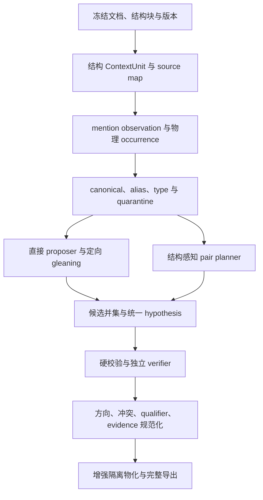

# Knowledge Forge 增强版 Shadow v2 全量修复执行指令

> 将本文件完整交给 Codex 执行。  
> 这是一项代码实现、数据库兼容、自动化测试、真实运行和自审任务，不是分析建议任务。  
> 本轮只修改 `enhanced_shadow / Shadow relation v2`，不得修复、重构或改变 Stable 的抽取与发布行为。

## 1. 任务目标

在仓库 `zjx2024/Knowledge-Forge` 中，持续完成增强版实体与关系流水线的系统性修复，直到：

1. 表格、列表、段落和重叠 Chunk 的来源结构可追踪；
2. 实体 mention、物理 occurrence、canonical、alias 和类型不再混为一层；
3. 空模型响应、协议错误和调用失败不会伪造成 `NO_RELATION`；
4. 增强版具有 Schema 引导的直接关系 proposer 和最多两轮定向 gleaning；
5. proposer 与确定性 pair planner 取并集，候选不再按哈希截断；
6. classifier、独立 verifier、方向、冲突、限定值和证据门禁形成闭环；
7. 真实请求、响应、证据、重试和失败状态可完整复核；
8. 能自动导出一套可复现、可对账的运行产物；
9. 全部工程门禁通过；若存在人工 Gold 和真实模型，则质量门禁也通过；
10. Stable 路径、正式实体/关系、正式向量、正式图和激活状态均保持不变。

本任务借鉴 RAGFlow 的高召回前端思想：在结构化上下文中直接提出关系并补抽遗漏；但不得照搬其宽松物化、无向通用边、缺少精确证据或不经过独立验证的做法。RAGFlow 代码只能作为只读参考，项目不得依赖 RAGFlow 服务或 API。

## 2. 审计基准与已确认事实

本指令编写时的审计基准是 PR #1 的 head：

```text
repository: zjx2024/Knowledge-Forge
branch:     fix/shadow-relation-quality-v2
commit:     ae5263bc632f13a76345e2962f955aad5b3f7ab0
```

执行时必须重新确认实际 HEAD，不得机械依赖旧 SHA 或本文行号。若当前工作树不是该提交，也不要擅自 reset、checkout、rebase 或覆盖已有修改；以当前代码为准重新定位同名功能。

当前增强版真实链路是：

```text
enhanced_shadow 入口
→ build_entity_shadow_namespace
→ extract_entities_only
→ SpanFirstEntityExtractor
→ ShadowEntityResolver
→ ShadowRelationV2Runtime.run_namespace
→ 同 Chunk 全 pair planner
→ classifier
→ deterministic validation
→ 单 hypothesis verifier
→ normalize
→ Shadow 数据库 ledger
→ enhanced 隔离图
```

当前没有 direct relation proposer，也没有关系 gleaning。已确认的基线结果为：

| 阶段 | 数量或现象 |
|---|---:|
| entity mentions | 337 |
| canonical entities | 265 |
| 唯一 canonical 名称 | 230 |
| pair opportunities | 4,934 |
| 距离过滤 | 4,070 |
| classifier 输入 | 746 |
| `NO_RELATION` | 691 |
| hypotheses | 105 |
| normalized facts | 33 |
| 人工严格判断明确正确 | 7 |
| 人工严格判断边界可接受 | 2 |
| 人工严格判断明确错误 | 24 |

已确认的根因包括：

- 结构解析过程产物中已有 `blocks`、`table`、`table_row`、headers 和 values，但 Shadow v2 只读线性 Chunk。
- mention ID 包含 `chunk_key + Chunk 局部 offset + type + surface`，重叠 Chunk 中同一物理提及会生成不同 ID。
- 多个 exact canonical 候选出现时，当前 resolver 会再创建一个 canonical，导致 `uncertain_ambiguous_exact` 持续膨胀。
- 当前类型约束主要是软分数，不能阻止明显跨类型误合并。
- singleton classifier 空数组会被改写为 `NO_RELATION`。
- pair planner 使用：

  \[
  sentence\_distance > 1 \;\lor\; character\_distance > 384
  \]

  作为硬过滤，并按 `pair_identity` 哈希顺序截预算。
- 当前 verifier persistence 把同一个 attempt hash 同时写入 `request_hash` 和 `response_hash`。
- 8 个共享通用谓词不足以表达 `is_a`、用途、统计、进口、储量、资助、出版、替代等事实。
- 当前 pilot 的成功条件只证明链路闭合，不能证明 33 条关系语义正确。
- 当前仓库没有可复现的 CSV/JSON 全量 exporter；已提交的 CSV 是静态产物，不是正式自动流水线的一部分。

Stable 的 0 条关系另有 verifier 批次协议故障，但不属于本轮范围。本轮不得顺手修复 Stable。

## 3. 持续执行协议

### 3.1 开始前

必须先执行：

```bash
git status --short --branch
git branch --show-current
git rev-parse HEAD
git rev-parse --show-toplevel
rg --files -g 'AGENTS.md' -g '!KnowledgeFiles/**'
```

然后：

1. 完整阅读根目录及相关子目录的 `AGENTS.md`。
2. 阅读 `README.md`、当前 migration、Shadow v2 代码、相关测试和 pilot 脚本。
3. 保留所有用户已有修改，不覆盖、不回滚、不清理无关文件。
4. 从仓库配置确认真实 Python、pytest、PostgreSQL 和 live test 命令，不臆造 formatter、linter 或 type checker。
5. 优先使用现有 `.venv/bin/python`；不要自动下载大型模型或启动/清空用户服务。
6. 记录基线 SHA、分支、Python 版本、依赖检查、目标测试结果和已有失败。

### 3.2 每阶段循环

每个阶段必须严格按以下顺序持续执行：

1. 先添加 characterization test 或会在旧实现上失败的新测试；
2. 确认测试失败原因与目标缺陷一致；
3. 实施本阶段最小完整闭环；
4. 运行本阶段 targeted tests；
5. 运行所有前序阶段回归；
6. 涉及数据库时运行 disposable PostgreSQL tests；
7. 自审状态机、幂等、隔离、证据、重试和 Stable 零影响；
8. 更新本地进度记录；
9. 阶段门禁全部通过后，自动进入下一阶段，不等待逐阶段确认。

建议将进度保存在未跟踪文件：

```text
.codex/work/enhanced-shadow-v2-remediation-progress.md
```

每个阶段记录：

```text
phase
status
files changed
tests added/changed
commands and exit codes
passed/failed/skipped counts
metrics before/after
known blockers
next phase
```

确定性测试在阶段结束时仍为红色，禁止进入下一阶段。不得通过删除测试、放宽断言、重复运行掩盖偶发失败或把 skipped 报成 passed。

### 3.3 允许暂停的情况

只有以下情况可以暂停并向用户提问：

- 缺少必须权限或凭据；
- 需要执行破坏性数据库操作；
- 当前工作树存在与本任务重叠、无法安全合并的未知用户修改；
- 产品语义存在会导致两种明显不同实现的重大歧义；
- 需要人类标注才能决定是否生产启用。

缺少人工 Gold、真实 Ollama、PostgreSQL 或 HugeGraph，只阻止相应 live/quality/release 阶段，不阻止继续完成可独立完成的代码、单测、fake-model 测试和文档。此时最终状态只能是 `engineering_complete`，不能声称质量或生产门禁通过。

## 4. 严格修改边界

### 4.1 Shadow 专属，可直接修改

- `knowledge_forge/relation_shadow_v2.py`
- `knowledge_forge/relation_shadow_runtime.py`
- `knowledge_forge/entity_shadow.py`
- `knowledge_forge/span_entities.py`
- Shadow v2 专属测试
- Shadow v2 pilot、freeze、export 和 evaluation 脚本

建议按仓库命名风格新增：

- enhanced-only 结构上下文模块；
- enhanced-only Schema overlay 模块；
- enhanced-only entity extraction/completion 模块；
- enhanced-only relation proposer 模块；
- enhanced-only artifact exporter 与 evaluator。

### 4.2 共享文件，只允许限定范围修改

- `knowledge_forge/service.py`
  - 仅 enhanced 入口、`build_entity_shadow_namespace()`、`_run_shadow_relation_v2_namespace()` 和 `_ingest_enhanced_strategy()`。
- `knowledge_forge/schema_evolution.py`
  - `extract_entities_only()` 若经 `rg` 证明只服务增强版，可限定修改；
  - 否则新建 enhanced-only extractor；
  - 不修改共享 `_sanitize_extraction()` 的 Stable 语义。
- `knowledge_forge/hugegraph_store.py`
  - 仅 enhanced strategy namespace 写入路径；
  - 不修改正式图同步。
- `knowledge_forge/database.py`
  - 只能增加 Shadow 专属 API、表或列；
  - 不改变产品表方法和默认查询语义。
- `knowledge_forge/migrations.py`
  - 新增 `0020+` migration；
  - 不改写 `0014`～`0019`。
- `knowledge_forge/config.py`、`.env.example`
  - 只新增 `SHADOW_RELATION_V2_*`、`ENTITY_SHADOW_*` 等增强专属配置；
  - 不改变旧 `RELATION_*` 默认值。
- `knowledge_forge/policy.py`
  - 只升级 P2/Shadow policy 版本；
  - 不改变 `CONTROL_POLICY_SET`。
- 公共 quality/release 文件
  - 只能增加明确命名的 Shadow v2 指标与门禁；
  - 不得静默改变 Stable 指标历史含义。

### 4.3 禁止触碰的 Stable 路径

不得修改下列函数或其行为：

- `KnowledgeForgeService._ingest_document()`
- `SchemaEvolutionService.extract_chunk()`
- `_relation_candidates()`
- `_needs_gleaning()`
- `_verify_relations()`
- `_review_relation_batch()`
- `_normalize_relation_verifier_response()`
- `_apply_relation_decision()`
- `_fail_relation_batch()`
- `EntityResolver` 和 `EntityResolver.resolve_chunk()`
- `VersionedRelationPipeline`
- `KnowledgeForgeService._run_relation_shadow()`，它是旧 P1 shadow，不是 v2
- `relation_verification.py`
- product entity/relation persistence
- Stable graph rebuild、正式 HugeGraph 同步和默认产品查询
- Stable strategy key、active Schema、production approval 和 control policy

特别要求：

- 不直接扩大共享 `BASE_SCHEMA`；
- 不为加入 proposer 而复用或改写 Stable 的 `extract_chunk()`；
- 不改变 Stable Chunk 文本、边界或 content hash；
- 不让增强结果写入正式实体、关系、向量、graph generation 或 activation。

必须新增或保留 tripwire 测试，证明：

```text
enhanced → legacy Stable calls = 0
enhanced → formal product writes = 0
stable   → enhanced-only calls = 0
```

## 5. 目标架构



核心原则：

- proposer/classifier 负责召回，不负责发布；
- verifier 只决定一个具体有向 hypothesis 是否被当前证据支持；
- 失败、空响应、未知、歧义和不完整始终 fail closed；
- 数量增加不是成功条件；
- 结构化表格值优先作为 qualifier，不默认成为实体；
- 同一物理 occurrence 与多个重叠 Chunk observation 必须分离；
- 所有行为版本进入 fingerprint。

## 6. 核心数据契约

### 6.1 结构上下文

实现等价于以下语义的数据结构：

```python
@dataclass(frozen=True)
class ContextUnit:
    context_id: str
    namespace_id: str
    document_revision_id: str
    context_kind: str
    rendered_text: str
    rendered_hash: str
    source_block_keys: tuple[str, ...]
    source_map: tuple["SourceMapEntry", ...]
    structure: dict[str, Any]
    structure_quality: str


@dataclass(frozen=True)
class SourceMapEntry:
    rendered_start: int
    rendered_end: int
    anchor_kind: str
    block_key: str
    block_local_start: int
    block_local_end: int
    table_id: str = ""
    row_id: str = ""
    cell_id: str = ""
    page: int | None = None
```

`ContextUnit` 至少支持：

- paragraph；
- clause/sentence；
- apposition；
- table；
- table row；
- table cell/header path；
- list item；
- heading scope。

模型使用的 rendered text 必须能无歧义映射回原始 block/chunk/cell。不得把合成的文件名、章节 ID、来源文档和分块头部当作可抽取正文。

### 6.2 observation 与物理 occurrence

当前 `mention_key` 只能表示一次 Chunk observation，不能继续充当物理 occurrence。

物理 occurrence 的稳定身份必须基于：

```text
revision_id + source anchor + exact surface
```

文本锚点：

```text
revision_id + block_key + block-local start/end
```

表格锚点：

```text
revision_id + table_id + row_id + cell_id + cell-local start/end
```

规则：

- 同一 source anchor、同一 exact surface：一个 occurrence；
- 同一 occurrence 可对应多个重叠 Chunk observation；
- 相同名称但不同 source anchor：保留为不同 occurrence；
- 仅 normalized name 相同不得做 occurrence 去重；
- occurrence identity 不包含 entity type 或 policy version；
- 无可靠 source map 时保留 chunk-local fallback，并标记降级质量，不冒险跨 Chunk 合并。

### 6.3 pair、context 与 candidate source

同一无序物理 pair 可出现在多个 ContextUnit。数据模型必须区分：

- pair opportunity；
- pair context；
- candidate source；
- directed hypothesis。

候选来源至少包括：

```text
DIRECT_PROPOSER
RELATION_GLEANING
TABLE_STRUCTURE
PAIR_PLANNER
ENDPOINT_COMPLETION
```

Hypothesis 必须绑定具体 pair context 和证据来源，否则不同上下文的事实会被错误折叠。

### 6.4 qualifier

日期、年份、估计标记、金额、百分比、产量和储量默认作为关系 qualifier，不作为 canonical entity：

```json
{
  "name": "amount",
  "value_text": "220,000",
  "normalized_value": 220000,
  "unit": "metric_tons",
  "period": "2024",
  "estimated": true,
  "source_refs": ["table_1/r1/c2"]
}
```

所有 qualifier 必须有精确来源引用，并进入事实 identity 或冲突范围所需的 versioned 规范化规则。

### 6.5 模型调用审计

新增统一的 Shadow 模型调用 envelope，至少保存：

```text
call_id
run_id / namespace_id
stage
unit_id
attempt_no
status
model_name
model_revision
system_prompt
request_payload
raw_response_text
parsed_response
request_hash
response_hash
prompt_version
schema_version
parser_version
token usage
error_type
error_message
parent_call_id
timestamps
```

真实哈希必须分别计算，并使用领域分隔：

```python
request_hash = sha256(b"request\0" + exact_request_bytes)
response_hash = sha256(b"response\0" + exact_response_bytes)
```

不得从同一个 attempt 摘要对象生成两个哈希。规则终态没有模型响应时，应显式记录 `independent_call=false` 和空响应字段，不能伪装成模型调用。

如果现有 `json_chat()` 只返回解析对象，为 Shadow 新增 audited envelope 接口；Stable 继续使用原接口。

## 7. 分阶段实施任务

## E0：冻结基线、修正指标口径、锁定 Stable 不变量

### 实现

1. 冻结当前 Shadow v2 代码、配置、Prompt、Schema、model digest 和基线产物 hash。
2. 为已发现错误建立最小、可公开的工程 fixture，不把模型生成标签冒充人工 Gold。
3. 拆分当前混合指标：
   - 无序 pair candidate recall；
   - predicate accuracy；
   - direction accuracy；
   - evidence accuracy；
   - verifier precision/recall；
   - final strict relation F1。
4. 类型统计按 canonical 主键对账，一个 canonical 只能计入一个 primary type。
5. 增加 Stable/Enhanced 双向 tripwire。

### 必改测试

- `tests/test_shadow_relation_gold_v2.py`
- `tests/test_shadow_relation_quality_v2.py`
- `tests/test_release_gate_artifacts.py`

建议新增：

- `tests/test_shadow_v2_metric_decomposition.py`
- `tests/test_shadow_v2_artifact_contract.py`
- `tests/test_shadow_v2_stable_invariance.py`

### 阶段门禁

- 当前 `2026-07-27-native-v2` 不能仅因 33 条均有 `SUPPORTED` 记录而通过语义门禁。
- 方向正确但证据错误时，方向指标与证据指标必须独立。
- pair planner 指标必须使用无序 occurrence pair。
- 指标缺失、NaN、分母不足或 Gold 不完整时 fail closed。
- Stable 行为 tripwire 全部通过。

## E1：修复空响应、重试、真实请求响应取证

### 实现

1. 删除 singleton 空数组自动转 `NO_RELATION` 的行为。
2. 新 policy 下，显式错误、缺失或未知 pair ID 均必须失败关闭，不得由调用者补写或覆盖。历史 parser 只能读取旧产物，不能参与新运行。
3. 新增 classifier attempt 状态：

```text
ACCEPTED
RETRYABLE_EMPTY
RETRYABLE_PROTOCOL
RETRYABLE_TRUNCATED
RETRYABLE_TIMEOUT
RETRYABLE_MODEL_ERROR
TERMINAL_FAILED
SUPERSEDED
```

4. pair decision 明确区分：

```text
EXPLICIT_NO_RELATION
SCHEMA_GAP
HYPOTHESES_EMITTED
CLASSIFICATION_PENDING
CLASSIFICATION_FAILED
```

5. 只有模型显式返回合法 pair ID、非空 reason 和可核验 context/evidence 的 `NO_RELATION` 才是真负例。
6. batch 失败时：
   - 保留已成功 pair；
   - 对 missing/invalid pair 缩小批次重试；
   - 必要时拆到 singleton；
   - 耗尽次数后标记 terminal failure；
   - 绝不整批清零或伪造负例。
7. verifier 的空响应、非法 JSON、超时和模型异常同样重试；耗尽后保留 terminal failure。
8. 保存每次真实请求、原始响应、解析结果、独立 hash、usage 和 error。
9. 重放与恢复不得生成重复 hypothesis、attempt、fact 或 evidence。

### 必须有意修改的旧测试

- 将 `test_single_pair_empty_classifier_items_is_negative_only` 改为：空响应可重试，耗尽后失败，不得成为 `NO_RELATION`。
- 将显式错误 pair ID 被调用者覆盖的断言改为 fail closed。
- singleton 仍可作为重试批次大小，但其响应必须显式携带正确 pair ID，不得因批次只有一项而放宽协议。

建议新增：

- `tests/test_shadow_relation_retry_v2.py`
- `tests/test_shadow_relation_attempt_audit_v2.py`

### 阶段门禁

- 空响应转负例数量为 0。
- 所有独立模型调用的 request/response hash 可从保存 payload 重算。
- 规则终态与真实模型调用数量分别统计。
- 任一 terminal model failure 时，run 不得标记为完整 ready。
- Shadow restricted role 仍无法写产品表。

## E2：增强专用结构 ContextUnit 与 source map

### 实现

优先复用已持久化的 parsing/processing payload 中的：

```text
blocks
sections
chunks
table
table_row
headers
values
page
metadata
```

不要先重写整个 PDF 解析器，也不要在 relation runtime 中临时重新解析 PDF。

1. `build_entity_shadow_namespace()` 读取冻结 revision 对应的结构过程产物。
2. 构建 enhanced-only ContextUnit 和 source map。
3. 将结构 artifact hash、parser version 和 source-map policy 写入 namespace fingerprint。
4. 表格至少保留：
   - table ID；
   - caption/title；
   - row ID；
   - column index；
   - header path；
   - cell role；
   - value、unit、estimated flag；
   - page；
   - 可用时的 bbox。
5. 表格 relation context 只拼接必要的表题、header path、当前行、单位和脚注，不默认拼接相邻国家行。
6. 列表必须区分 governing phrase 与每个 list item；相邻 peer 不能因线性相邻形成关系。
7. contact block、页眉、页脚、页码、目录和重复表头应有明确结构角色。
8. 若历史 revision 无 source map，显式标记 `legacy_chunk_local`；不得声称表格结构完整。
9. 如需在共享 parsing 层增加元数据，只能新增 source mapping；Stable Chunk 文本、边界和 content hash 必须由测试证明完全不变。

建议新增：

- `tests/test_table_structure_extraction.py`
- `tests/test_shadow_context_source_map.py`
- `tests/test_shadow_v2_stable_chunk_hash.py`

### 阶段门禁

- 表头到 cell 的归属可重建。
- 任意 rendered evidence 都能映射回原始来源。
- 相邻国家行不会共享错误关系上下文。
- Stable Chunk 文本、边界、hash 完全不变。

## E3：实体 observation、physical occurrence、类型和 canonical 修复

### 实现

#### 实体抽取目标

将 enhanced-only entity Prompt 从“every explicit mention”改为：

> 抽取可复用、能作为知识图谱关系端点、具有明确来源的实体 mention。

默认排除：

- 单独日期、年份和 `2024e`；
- 金额、数量、百分比、电话号码；
- 表头、单位、页码、脚注编号；
- `domestic`、`foreign` 等无独立指称的修饰词；
- 仅作为表格分隔或统计标记的文本。

这些内容进入 qualifier/structure；只有 enhanced Schema 明确定义相应实体类型时才例外。

#### endpoint completion

在 occurrence universe 冻结前增加最多一轮关系端点补漏：

- 只返回遗漏的关系端点 mention；
- 必须引用精确 source anchor；
- 仍经过 span、结构、type 和 resolver 门禁；
- 完成后再冻结 assignment fingerprint；
- proposer 运行后不得临时创造实体；
- 若 proposer 发现缺失端点，只记录 `MISSING_ENDPOINT` 并触发下一次 namespace rebuild。

#### occurrence

新增 observation→physical occurrence 映射；同一重叠来源只产生一个 occurrence，同时保留全部 Chunk provenance。

#### 类型

建立 enhanced-only type overlay 和兼容矩阵，至少覆盖：

```text
Person
Organization
Location
Facility
Material
Product
Technology
Process
Industry
Application
Project
ProgramOrPolicy
Publication
EventOrTrend
GenericEntity
```

要求：

- `Location` 与 `Material` 硬不兼容；
- `Product`、`Material` 不得只凭 embedding 自动合并；
- `GenericEntity` 表示未解析，不代表与所有类型自动兼容；
- canonical 类型可由多条证据提升，但不能被一次低置信 assertion 任意漂移；
- 合法 confidence `0` 必须保留为 `0`。

#### alias

alias 至少分级：

```text
primary_name
surface_observation
explicit_alias
explicit_acronym
orthographic_variant
manual_alias
legacy_unverified
```

只有 primary name、明确来源 alias、同上下文全称—缩写和确定性正字变体可进入 exact auto-merge。首字母相似本身不构成 acronym merge 证据。

#### exact ambiguity

多个 exact candidate 时：

1. 去除 cannot-link 和 identifier/type conflict；
2. 折叠已有 redirect 的重复代表；
3. 唯一代表则赋值；
4. 多个真实候选则做有界上下文裁决；
5. 仍不确定则进入 `QUARANTINED/REVIEW_REQUIRED`；
6. 不得为歧义 mention 再创建一个正常 canonical；
7. quarantined occurrence 不进入 pair planner。

不要用全局 `normalized_name + type` 唯一约束粗暴消灭真实同名异义。重复 canonical 合并必须可逆并保留 Shadow event。

### 固定回归案例

- Canada 多次出现只形成一个 active canonical；
- Australia 多次出现只形成一个 active canonical；
- U.S./United States 有明确证据时归一；
- EV/EVs/electric vehicles 仅有明确 alias 证据时归一；
- `lithium chloride != lithium carbonate`；
- `lithium compounds != lithium carbonate`；
- 同一重叠 occurrence 去重；
- 同名不同真实位置保留不同 occurrence；
- 真实 homonym 不误合并；
- 日期、表头、电话、金额、吨数不进入 canonical。

建议新增：

- `tests/test_shadow_entity_occurrence_dedup.py`
- `tests/test_shadow_entity_quality_regressions.py`
- `tests/test_shadow_entity_gold_metrics.py`

### 阶段门禁

- 同一 physical occurrence 不因重叠 Chunk 重复计数。
- 歧义 exact 不再制造第三个 canonical。
- hard type/cannot-link 误合并为 0。
- assignment confidence 不再全部固定为 0.5。
- Gold 关系所需端点能在 entity 阶段召回。

## E4：增强专用 Schema overlay 与 qualifier policy

### 实现

创建 enhanced-only、versioned、进入 fingerprint 的 relation overlay，不直接修改共享 `BASE_SCHEMA`。

建议谓词：

| Predicate | 规范方向 |
|---|---|
| `is_a` | 实例/具体对象 → 类别 |
| `part_of` | 部件 → 整体 |
| `belongs_to` | 成员/所属物 → 所属方 |
| `located_in` | 设施、项目、组织或资源 → 地点 |
| `produces` | 生产者、设施或地区 → 材料/产品 |
| `uses` | 使用者、行业或工艺 → 被使用对象 |
| `used_in` | 材料、产品或技术 → 应用/行业/工艺 |
| `used_as` | 材料/产品 → 用途或角色 |
| `imports_from` | 进口方 → 来源方 |
| `exports_to` | 出口方 → 目的方 |
| `processed_in` | 材料/产品 → 加工设施或地点 |
| `has_production` | 地区/企业/设施 → commodity，数值作 qualifier |
| `has_reserve` | 地区 → commodity，数值作 qualifier |
| `has_resource` | 地区 → commodity |
| `funded_by` | 项目/接收方 → 资助方 |
| `operated_by` | 设施/项目 → 运营组织 |
| `published_by` | 报告/出版物 → 出版组织 |
| `substitutes_for` | 替代材料/技术 → 被替代对象 |
| `depends_on` | 依赖方 → 依赖对象 |
| `causes` | 原因状态/事件 → 结果状态/事件 |
| `related_to` | 保持 `review_only` |

每个 predicate 元数据必须包含：

```text
semantic_definition
domain_types
range_types
direction_description
subject_role_description
object_role_description
symmetric
inverse_predicate
canonical_orientation
reflexive
reciprocal_allowed
publish_mode
allowed_context_kinds
required_evidence_roles
positive_examples
negative_examples
positive_cues
negative_cues
anti_patterns
qualifier_schema
identity_qualifier_keys
conflicts_with
negation_policy
modality_policy
```

规则：

- overlay 与项目 active Schema 同名但定义不兼容时 fail closed；
- predicate metadata 的所有行为字段进入 fingerprint；
- Gold 样本不足的 predicate 保持 `review_only`；
- Schema gap 必须输出 `OTHER_UNSUPPORTED/SCHEMA_GAP`；
- 不得把无法表达的事实硬映射为 `produces`、`part_of` 或 `related_to`；
- 不在 Python 控制流中按某个具体 commodity、国家或文档名称写分支。

建议新增：

- `tests/test_shadow_relation_schema_industry_v2.py`
- 完善当前空白或不足的 `tests/test_shadow_relation_predicate_policy_v2.py`

### 阶段门禁

- 所有 predicate metadata 完整、可校验、可 fingerprint。
- `uses/used_in/used_as`、资助、出版、同位和统计关系方向有独立测试。
- Stable active Schema 和 Stable 结果不变。

## E5：direct relation proposer、endpoint completion 与 gleaning

### 输入契约

每个 ContextUnit 传入：

```json
{
  "context_id": "...",
  "context_kind": "table_row",
  "text": "...",
  "structure": {},
  "occurrences": [
    {
      "occurrence_id": "...",
      "surface": "Example",
      "type": "Location",
      "source_refs": []
    }
  ],
  "predicates": {},
  "already_found_keys": []
}
```

### 输出契约

```json
{
  "proposals": [
    {
      "subject_occurrence_id": "...",
      "predicate": "has_production",
      "object_occurrence_id": "...",
      "evidence_refs": [],
      "qualifiers": [],
      "confidence": 0.82
    }
  ],
  "missing_endpoint_mentions": [],
  "coverage": {
    "complete": true,
    "uncovered_cues": []
  }
}
```

约束：

- endpoint ID 必须来自输入；
- predicate 必须来自当前 overlay；
- evidence ref 必须属于当前 ContextUnit；
- confidence 只用于候选排序，不能作为发布依据；
- 空 `proposals` 是合法明确结果；
- 空/缺失整个响应是调用失败，不是无关系；
- missing endpoint 不能直接生成 fact。

### gleaning

1. pass 0：抽取所有明确关系；
2. glean 1：只补未出现的 hypothesis key；
3. glean 2：仅在高价值表格、`coverage.complete=false` 或存在未覆盖 cue 时执行；
4. 最多两轮；
5. 每轮 request、response、解析结果和新增 proposal 数独立保存；
6. 无新 proposal 或 coverage complete 时立即停止；
7. 禁止为了“必须输出”而制造关系。

Proposer hypothesis 不需要再经过 pair classifier，但必须进入与 classifier hypothesis 完全相同的 deterministic validation、独立 verifier、normalizer 和物化门禁。

建议新增：

- `tests/test_shadow_relation_proposer_v2.py`
- `tests/test_shadow_relation_gleaning_v2.py`
- `tests/test_shadow_relation_missing_endpoint_v2.py`

### 阶段门禁

- proposer 不能发明 endpoint、predicate 或 evidence。
- gleaning 不重复已有事实且最多两轮。
- `cobalt-bearing nickel concentrate` 一类关系必要端点可由 endpoint completion 找回。
- proposer 输出不能绕过 verifier。

## E6：结构感知 pair planner、候选并集、优先级和 classifier

### planner admission

删除“句距/字符距二选一硬拒绝”作为所有结构的统一规则。使用等价于：

```python
admitted = any([
    same_clause,
    same_sentence,
    same_paragraph_with_schema_cue,
    apposition_structure,
    same_table_row,
    row_header_to_column_or_caption_entity,
    same_cell,
    explicit_list_governing_relation,
    direct_proposer_pair,
])
```

明确过滤：

```text
same canonical
quarantined endpoint
hard type incompatible
header/footer/page number
pure list peers without governing relation
neighboring table rows
telephone/contact adjacency
```

句距和字符距只能作为 prose fallback feature。表格同行、header path 和 list governing structure 不受 `sentence_window=1` 限制。

### 候选并集

- `DIRECT_PROPOSER` 已经是有向 predicate hypothesis；
- `PAIR_PLANNER` 只是无序 pair，需要 classifier；
- 两者共享 pair ledger，来源独立；
- proposer 与 planner 同一 pair 时合并来源，不重复 hypothesis；
- planner classifier 的 `NO_RELATION` 不能覆盖已存在的 proposer hypothesis，应记录 source disagreement，由 verifier 决定。

### 优先级

删除按 hash 优先截断。使用 versioned、确定性的字典序 priority：

```python
priority = (
    source_rank,
    structure_rank,
    type_rank,
    cue_rank,
    sentence_distance,
    character_distance,
    pair_context_id,
)
```

最后一个 ID 只能作稳定 tie-break。

预算要求：

- direct proposer hypothesis 不占 planner pair budget；
- 表格结构候选有独立配额；
- 按 occurrence 或 ContextUnit round-robin，避免单个 dense Chunk 占满预算；
- 超预算保留 `DEFERRED_BUDGET`、priority 和原因；
- 不静默丢弃；
- Gold positive 因 deferred/overflow/failed 遗漏时 release gate 失败。

### classifier

- planner-only pair 才调用 classifier；
- `NO_RELATION` 必须有非空 reason 和覆盖两端的 context/evidence；
- 增加明确 `UNCERTAIN`，不得强迫模型二选一；
- parser 只接受当前 versioned contract；
- JSON repair 只能作为显式、可审计的 retry attempt，不能静默修复后声称首轮成功。

建议新增：

- `tests/test_shadow_relation_structure_candidates_v2.py`
- `tests/test_shadow_relation_candidate_union_v2.py`
- `tests/test_shadow_relation_priority_budget_v2.py`

### 阶段门禁

- 表格同行和 header-cell Gold pair 可进入候选。
- 相邻国家、材料、金额不会因相邻而进入错误 pair。
- 候选预算不再按 hash 决定。
- proposer ∪ planner 的每个候选都有唯一、可对账终态。

## E7：独立 verifier、方向、冲突、证据和 qualifier 门禁

### verifier 输入

每次只验证一个具体 hypothesis，包括：

- ordered subject；
- predicate 完整语义和方向；
- ordered object；
- 最小 ContextUnit；
- 表格 header/row/cell 结构；
- proposer/classifier evidence refs；
- qualifiers；
- occurrence source anchors。

不要向 verifier 传 classifier confidence，避免锚定偏差。

### verifier 响应

建议采用：

```json
{
  "verdict": "SUPPORTED",
  "reason_code": "DIRECTLY_ENTAILED",
  "checks": {
    "subject_present": true,
    "object_present": true,
    "predicate_entailed": true,
    "direction_supported": true,
    "not_negated": true,
    "modality_supported": true,
    "structure_alignment_supported": true
  },
  "supported_evidence_refs": [],
  "normalized_qualifiers": []
}
```

`SUPPORTED` 必须同时满足：

- 两个 endpoint occurrence 精确存在；
- predicate 语义由证据直接支持；
- 方向正确；
- 否定、条件、可能性、预测和引用范围正确；
- 表格行列映射正确；
- evidence 覆盖两端及关系线索，或完整表格 header→row→cell 路径；
- qualifier 可回溯到 source span/cell。

Verifier evidence 可在冻结 ContextUnit 内选择比 classifier span 更完整的证据，但不能逃逸出冻结来源。不得继续要求它只能是 classifier span 的子集。

若 verifier 提出 corrected predicate/orientation：

- 原 hypothesis 保持 rejected；
- correction 创建新的、可审计 hypothesis；
- 新 hypothesis 必须重新经过全部硬校验和独立 verifier；
- correction 不得直接发布。

### 冲突门禁

必须阻止：

- 同一证据支持非 symmetric predicate 的双向关系；
- apposition 被输出为 `produces/uses/part_of`；
- 列表相邻国家之间的 `located_in/produces`；
- Publication 与 publisher 方向反转；
- 资助方、法律或金额被解释为 produced object；
- `used_in/uses` 角色反转；
- 同一 evidence scope 上的互斥谓词；
- 同一 triple 和时间范围的 qualifier 数值冲突；
- stale canonical assignment；
- 无独立 evidence 的 reciprocal。

不要建立过宽的全局互斥。例如企业可能既生产又使用某种材料。冲突必须结合 predicate metadata、evidence scope、时间 qualifier 和结构模式。

非 symmetric reciprocal 只有在 Schema 允许、两方向各有独立证据且均被 verifier 支持时保留。

### 固定语义回归

- `potassic fluxes uses glass manufacture`：方向错误；
- `Lithium minerals produces mineral concentrates`：应识别 `used_as` 语义；
- Eagle Mine 与 `nickel-copper mine`：apposition / `is_a`，不是双向 `produces`；
- `Zimbabwe located_in Chile`：列表串联；
- `Mineral Commodity Summaries produces USGS`：出版方向错误；
- DOE/法律 `produces $44.8 million`：资助/金额误判；
- cobalt-free substitutes 指代错接；
- 否定、条件、可能性和历史事实；
- 正确的 `part_of`、`uses`、`located_in`、`produces`。

建议新增：

- `tests/test_shadow_relation_semantic_regressions_v2.py`
- `tests/test_shadow_relation_evidence_v2.py`
- `tests/test_shadow_relation_conflicts_v2.py`
- `tests/test_shadow_relation_live_gold_v2.py`

### 阶段门禁

- 所有物化候选均来自 independent `SUPPORTED`。
- evidence offset/text/source ref 完整率 100%。
- 已知 24 条错误模式不能再进入 eligible。
- stale、冲突、无 verifier、无证据、错误方向事实均不可物化。

## E8：迁移、持久化、fingerprint、完整 exporter

### migration

在现有 `0019` 之后增加一个或多个 additive migration。不得改写历史 migration checksum。

建议新增或等价实现：

```text
shadow_source_contexts
shadow_context_source_maps
entity_shadow_occurrences
entity_shadow_mention_occurrence_map
entity_shadow_occurrence_assignments
entity_shadow_canonical_redirects
shadow_model_calls
shadow_model_call_members
shadow_relation_pair_contexts
shadow_relation_candidate_sources
shadow_relation_proposal_attempts
shadow_relation_proposals
shadow_relation_evidence_refs
```

旧表只能增加兼容字段，例如：

```text
pipeline_generation
context_id
source_kind
source_record_id
qualifiers
model_call_id
audit_quality
terminal_status
```

兼容要求：

- DDL 幂等、可在已有数据库安全升级；
- 不删除或重写历史 Shadow 数据；
- 历史 run 不回填伪造 raw request/response；
- 旧 hash 标记为 `legacy_audit_incomplete`；
- 新 reader 可读旧 run，但旧 run 永远不能通过新审计契约；
- 新 Shadow 表继续受数据库“禁止写产品表”保护；
- 所有 project/document/revision/namespace 外键和索引完整；
- 重试不覆盖 append-only attempt；
- policy 变化后不复用旧 ready run。

### fingerprint

至少加入：

```text
structure_artifact_hash
source_map_policy
occurrence_policy
entity_extraction/completion policy
entity_type_policy
alias_policy
canonical_resolution_policy
enhanced_schema_overlay_hash
proposer prompt/schema/parser/model digest
gleaning policy and max rounds
pair structural policy
candidate priority policy
classifier contract/model digest
verifier contract/model digest
conflict policy
qualifier normalization policy
audit serializer version
release policy version
```

### exporter

新增正式 enhanced-only exporter，不能再依赖手工 CSV。至少导出：

```text
freeze-manifest.json
run-summary.json
structure-contexts.jsonl
source-maps.jsonl
mentions.csv
mention-appearances.csv
occurrences.csv
entities.csv
resolution-outcomes.csv
assignments.csv
model-calls.jsonl
proposal-attempts.jsonl
proposals.csv
pair-ledger.csv
pair-contexts.csv
classifier-attempts.jsonl
hypotheses.csv
verifications.csv
normalized-facts-with-evidence.csv
fact-evidence.jsonl
qualifiers.jsonl
conflicts.csv
pair-status-summary.csv
verification-verdict-summary.csv
response-quality.json
metric-summary.json
audit-report.md
```

导出必须自动验证：

- 所有唯一键不重复；
- 所有外键可连接；
- pair ledger 终态守恒；
- type 数之和等于 canonical 主类型总数；
- 规则终态与 independent model calls 对账；
- facts 全部有非空、可定位 evidence；
- request/response hash 可重算；
- 空 response 不被计为 `NO_RELATION`；
- classifier/proposer/verifier 的 attempts 与最终状态一致；
- run fingerprint 与 freeze manifest 一致；
- 旧 `2026-07-27-native-v2` 目录不被覆盖。

建议新增：

- `scripts/export_shadow_v2_evaluation_bundle.py`
- `tests/test_shadow_v2_artifact_exporter.py`
- `tests/test_shadow_relation_migrations_postgres.py` 的新 migration 覆盖。

### 阶段门禁

- exporter 一条命令可重建完整审计包。
- 导出对账失败时返回非零退出码。
- 数据库重放和重复导出结果确定性一致。
- 旧历史产物保持只读。

## E9：受控 E2E、Gold 评估、三次重复与最终回归

### pilot 脚本

修改或新增端到端 pilot，使其：

- 从冻结文档重新构建 enhanced entity 和 relation namespace；
- 不只克隆旧 entity snapshot；
- 不再按历史 endpoint 数量选择 namespace，也不在代码中固定“必须 2 篇文档/15 个 Chunk”；样本范围由显式参数和 freeze manifest 决定；
- 保留 legacy tripwire；
- 保留 formal graph unchanged、formal writes=0、activation=0；
- 结构工程门禁与语义质量门禁使用不同状态和退出码；
- 不再用 `supported_verification_ratio == 1.0` 代表语义质量；
- 输出 stage-level token、调用数、延迟、重试、失败和 deferred；
- 可调用正式 exporter 与 evaluator；
- 不自动激活或写正式图。

### E2E 顺序

1. 使用相同源文件 hash 冻结文档、revision、结构、Schema、配置和模型 digest；
2. preflight；
3. fresh enhanced entity+relation run；
4. 导出完整 artifact bundle；
5. 运行 engineering gate；
6. 有人工 Gold 时运行 pilot quality gate；
7. 有 release Gold 时运行 production eligibility gate；
8. 固定全部版本连续运行三次；
9. 比较三次的安全、质量、失败率和成本；
10. 不满足门禁则继续定位、修复和重跑受影响阶段。

关系数量只能作为诊断分母，绝不能作为通过条件。

## 8. Gold 数据规范

### 8.1 当前两份 USGS pilot

对当前两份 PDF、15 个冻结结构块完整标注：

- 所有实体 mention、类型和 canonical；
- 所有当前增强 Schema 可表达的显式正关系；
- 所有 Schema gap；
- 当前发布预测的 precision adjudication；
- 表格、列表、apposition、方向、指代、否定、金额和模态 hard negatives；
- 一个或多个可接受 evidence span；
- 表格证据的 table/row/cell/header path；
- 当前 33 条预测全部标注，不能只标正确关系。

该 pilot 用于开发回归，不能单独授权生产。

### 8.2 release Gold 最低规模

| 项目 | 最低要求 |
|---|---:|
| items/结构块 | 200 |
| 领域 | 2 |
| mentions | 500 |
| must-links | 150 |
| cannot-links | 150 |
| 正关系 | 200 |
| hard negatives | 300 |
| holdout | 按文档划分，至少 30% |
| holdout 正关系 | 60 |
| holdout hard negatives | 90 |

附加要求：

- 覆盖表格、普通段落、列表/OCR；
- 每个自动发布 predicate 至少 20 个正例和 20 个 hard negative；
- apposition、列表串联、反向用途/生产、funding/amount、publication、coreference、negation/modality 各至少 20 个 hard-negative 样例；
- dev/holdout 按文档隔离；
- holdout 不得进入 Prompt 示例、Schema 示例或阈值调优；
- 两名标注者独立标注，第三人仲裁；
- 发布前争议解决率 100%；
- 关系标签预仲裁 Cohen’s κ 建议不低于 0.80。

### 8.3 Gold 必需字段

```text
document_id
revision_id
source file hash
structure/parser hash
chunk/block/table policy hash
document-absolute/source-anchor mention coordinates
block/chunk local coordinates
mention ID, surface, type, canonical ID
must-link / cannot-link
relation subject occurrence/canonical
predicate
object occurrence/canonical
direction
acceptable evidence spans/refs
table/row/cell/header path
qualifiers
polarity
modality
schema support
critical flag
pair decision
label source
annotator/reviewer
adjudication status
Gold/code/Prompt/model/Schema/policy/evaluator versions and hashes
```

不得把 Codex 或 LLM 自己生成的标签称为人工 Gold。

## 9. 指标与门禁

### 9.1 独立指标

必须分别计算并给出分母：

- mention exact-span precision/recall/F1；
- type macro-F1；
- Gold relation endpoint mention recall；
- entity candidate Recall@K；
- pairwise clustering F1；
- B³ precision/recall/F1；
- false-merge rate；
- duplicate canonical rate；
- unordered endpoint pair Recall@budget；
- proposer strict recall；
- predicate micro/macro-F1；
- direction accuracy，分母为端点与 predicate 已匹配的 Gold；
- evidence offset validity；
- evidence exact-boundary F1；
- evidence human-support precision；
- verifier `SUPPORTED` precision/conditional recall；
- final canonical relation precision/recall/F1；
- final strict relation precision/recall/F1；
- prose/table/list 分层指标；
- token、调用、延迟、重试和失败指标。

不得继续使用会把方向、端点和证据混在一起的旧复合口径。

### 9.2 工程硬门禁

无论是否有人类 Gold，都必须满足：

- pair、hypothesis、attempt、fact、evidence ledger 100% 守恒；
- 空响应转负例为 0；
- unknown/duplicate/missing correlation ID 为 0；
- request/response hash 可重算率 100%；
- facts evidence text/source ref 完整率 100%；
- `content[start:end] == evidence_text` 或 table cell source ref 校验率 100%；
- terminal model failure 不得被标为完整 ready；
- Gold positive 不得因静默丢弃而消失；
- legacy Stable 调用为 0；
- 正式产品表写入为 0；
- activation 为 0；
- migration 幂等；
- exporter 对账全部通过；
- targeted、前序回归和最终全量确定性测试全部通过。

### 9.3 Production 最低质量门槛

只有正式 human release Gold 满足最低规模时才计算：

| 层级 | 最低门槛 |
|---|---:|
| mention exact-span P/R/F1 | 各 ≥ 0.90 |
| Gold relation endpoint mention recall | ≥ 0.98 |
| type macro-F1 | ≥ 0.85 |
| entity candidate Recall@K | ≥ 0.99 |
| pairwise clustering F1 | ≥ 0.90 |
| B³ F1 | ≥ 0.90 |
| cannot-link / hard identifier 误合并 | 0 |
| deterministic exact-alias duplicate canonical | 0 |
| 全部 duplicate canonical rate | ≤ 1% |
| Gold endpoint unordered pair Recall@budget | ≥ 0.99 |
| critical/table Gold pair recall | 1.00 |
| predicate micro-F1 | ≥ 0.90 |
| predicate macro-F1 | ≥ 0.85 |
| 自动发布 predicate 单类 precision | ≥ 0.85 |
| direction accuracy | ≥ 0.95 |
| evidence offset/text/hash 完整率 | 1.00 |
| evidence exact-boundary F1 | ≥ 0.90 |
| evidence human-support precision | ≥ 0.95 |
| verifier `SUPPORTED` precision | ≥ 0.95 |
| verifier conditional recall | ≥ 0.90 |
| verifier hard-negative false support | ≤ 2%，critical 为 0 |
| canonical relation precision | ≥ 0.90 |
| canonical relation recall | ≥ 0.80 |
| canonical relation F1 | ≥ 0.85 |
| strict relation precision | ≥ 0.90 |
| strict relation recall | ≥ 0.75 |
| strict relation F1 | ≥ 0.80 |
| critical Gold relation 遗漏 | 0 |
| Gold positive 因 deferred/failed 遗漏 | 0 |

置信区间同时要求：

- canonical/strict precision 的 Wilson 95% 下界 ≥ 0.85；
- canonical recall 的 Wilson 95% 下界 ≥ 0.75；
- verifier precision 的 Wilson 95% 下界 ≥ 0.90。

Gold 不足的 predicate 必须保持 `review_only`，不能通过降低阈值启用。

### 9.4 成本和失败门禁

按 stage 报告：

- prompt/output/total tokens；
- 模型调用次数；
- DB/图调用；
- p50/p95 latency；
- 首次失败、重试、恢复、最终失败；
- 每千输入 token 成本；
- 每个 strict TP 的 token、调用和时间。

Release 建议门槛：

- 100% Gold items 被处理；
- Gold 上 unresolved/deferred/permanent failure 为 0；
- residual model failure ≤ 0.5%；
- 首次 transient failure ≤ 5%；
- fault-injection 重试恢复率 100%；
- tokens/input token ≤ 冻结对照的 1.5 倍；
- model calls/item ≤ 1.5 倍；
- p95 latency/item ≤ 2 倍；
- tokens/strict TP ≤ 1.25 倍。

成本改善不能抵消安全、precision、recall 或 provenance 失败。

## 10. 测试矩阵与命令

实际文件名可按仓库风格调整，但覆盖不得减少。

### E0 指标与契约

```bash
.venv/bin/python -m pytest --strict-markers -q \
  tests/test_shadow_relation_gold_v2.py \
  tests/test_shadow_relation_quality_v2.py \
  tests/test_release_gate_artifacts.py \
  tests/test_shadow_v2_metric_decomposition.py \
  tests/test_shadow_v2_artifact_contract.py \
  tests/test_shadow_v2_stable_invariance.py
```

### E1 调用协议、重试与审计

```bash
.venv/bin/python -m pytest --strict-markers -q \
  tests/test_shadow_relation_classifier_v2.py \
  tests/test_shadow_relation_verifier_v2.py \
  tests/test_shadow_relation_runtime_wiring.py \
  tests/test_shadow_relation_retry_v2.py \
  tests/test_shadow_relation_attempt_audit_v2.py

.venv/bin/python scripts/run_disposable_postgres_tests.py \
  tests/test_shadow_relation_persistence_v2.py \
  tests/test_shadow_relation_public_entry_postgres.py \
  tests/test_shadow_relation_migrations_postgres.py
```

### E2～E3 结构与实体

```bash
.venv/bin/python -m pytest --strict-markers -q \
  tests/test_entity_shadow_independence.py \
  tests/test_document_chunk_preview.py \
  tests/test_entity_relation_funnel.py \
  tests/test_table_structure_extraction.py \
  tests/test_shadow_context_source_map.py \
  tests/test_shadow_entity_occurrence_dedup.py \
  tests/test_shadow_entity_quality_regressions.py \
  tests/test_shadow_entity_gold_metrics.py

.venv/bin/python scripts/run_disposable_postgres_tests.py \
  tests/test_entity_shadow_postgres.py
```

### E4～E6 Schema、proposer、planner 与 classifier

```bash
.venv/bin/python -m pytest --strict-markers -q \
  tests/test_shadow_relation_pairs_v2.py \
  tests/test_shadow_relation_predicate_policy_v2.py \
  tests/test_shadow_relation_schema_industry_v2.py \
  tests/test_shadow_relation_proposer_v2.py \
  tests/test_shadow_relation_gleaning_v2.py \
  tests/test_shadow_relation_missing_endpoint_v2.py \
  tests/test_shadow_relation_structure_candidates_v2.py \
  tests/test_shadow_relation_candidate_union_v2.py \
  tests/test_shadow_relation_priority_budget_v2.py
```

### E7 语义、证据、冲突与归一

```bash
.venv/bin/python -m pytest --strict-markers -q \
  tests/test_shadow_relation_classifier_v2.py \
  tests/test_shadow_relation_verifier_v2.py \
  tests/test_shadow_relation_normalization_v2.py \
  tests/test_shadow_relation_freshness_v2.py \
  tests/test_shadow_relation_semantic_regressions_v2.py \
  tests/test_shadow_relation_evidence_v2.py \
  tests/test_shadow_relation_conflicts_v2.py
```

真实模型可用时：

```bash
RUN_LIVE_MODEL_TESTS=1 .venv/bin/python -m pytest --strict-markers -q \
  -m live_model tests/test_shadow_relation_live_gold_v2.py
```

### E8 数据库、exporter 和隔离入口

```bash
.venv/bin/python -m pytest --strict-markers -q \
  tests/test_shadow_v2_artifact_exporter.py \
  tests/test_shadow_relation_runtime_wiring.py

.venv/bin/python scripts/run_disposable_postgres_tests.py \
  tests/test_shadow_relation_migrations_postgres.py \
  tests/test_shadow_relation_persistence_v2.py \
  tests/test_shadow_relation_public_entry_postgres.py \
  tests/test_entity_shadow_postgres.py
```

### 最终全量

```bash
.venv/bin/python -m pytest --strict-markers -q -ra \
  -m "not integration and not live_model and not hugegraph_integration"

.venv/bin/python scripts/run_disposable_postgres_tests.py \
  -m "not live_model and not hugegraph_integration"

.venv/bin/python -m py_compile \
  knowledge_forge/*.py scripts/*.py benchmarks/*.py server.py

.venv/bin/python -m pip check

git diff --check
git status --short --branch
git diff --stat
```

如果仓库没有 `benchmarks/*.py` 或某些建议测试尚未创建，应在对应阶段创建；不得通过删除命令中的核心覆盖范围逃避测试。若没有 formatter/linter/type checker 配置，如实说明，不得臆造。

## 11. E2E artifact 示例

实际参数以脚本实现和 `--help` 为准。不得把示例变量替换成真实生产数据库。

```bash
mkdir -p artifacts/shadow-v2/project-13/rc-v3

.venv/bin/python scripts/prepare_shadow_v2_pilot.py \
  --dsn "$KF_PILOT_DSN" --project-id 13

.venv/bin/python scripts/freeze_shadow_v2_pilot.py \
  --dsn "$KF_PILOT_DSN" \
  --output artifacts/shadow-v2/project-13/rc-v3/freeze.json \
  --native-project-id 13 \
  --frozen-legacy-project-id 12

.venv/bin/python scripts/run_shadow_v2_native_pilot.py \
  --dsn "$KF_PILOT_DSN" \
  --freeze artifacts/shadow-v2/project-13/rc-v3/freeze.json \
  --output artifacts/shadow-v2/project-13/rc-v3/preflight.json \
  --preflight-only

.venv/bin/python scripts/run_shadow_v2_native_pilot.py \
  --dsn "$KF_PILOT_DSN" \
  --freeze artifacts/shadow-v2/project-13/rc-v3/freeze.json \
  --output artifacts/shadow-v2/project-13/rc-v3/native-run.json \
  --rebuild-entity-shadow

.venv/bin/python scripts/export_shadow_v2_evaluation_bundle.py \
  --dsn "$KF_PILOT_DSN" \
  --run-id "<RUN_ID>" \
  --output artifacts/shadow-v2/project-13/rc-v3
```

要求：

- `--rebuild-entity-shadow` 或等价路径必须真实重建本轮实体，不得只克隆旧 namespace；
- pilot DSN 必须继续受现有 sentinel/disposable 命名和安全检查保护；
- 不覆盖 `2026-07-27-native-v2`；
- 不提交运行产物，除非用户另行明确要求；
- 无人工 Gold 时只运行 engineering gate。

## 12. 立即停止条件

出现以下任一情况，立即停止当前阶段，保留证据并修复：

- Shadow 写入正式实体、关系、向量、graph generation 或 activation；
- legacy/Stable 调用次数不为 0；
- stale、无 verifier、无效 evidence、`related_to` 或 Schema gap 被发布；
- 空响应被改写成负例；
- request/response 无法取证或 hash 不可重算；
- Gold/manifest/hash 漂移；
- dev/holdout 泄漏；
- migration 非幂等、损坏历史数据或无法回滚；
- 任一确定性 unit/integration test 失败；
- run 存在 terminal failure 却被标为完整 ready。

以下情况可继续工程实现，但不得 release：

- 缺少人工 Gold；
- PostgreSQL、Ollama 或 HugeGraph 暂时不可用；
- live tests 仅因未配置而跳过；
- 成本门禁失败但安全与确定性测试通过；
- 某 predicate Gold 不足，此 predicate 保持 `review_only`。

## 13. 明确禁止

- 禁止只把 `sentence_window` 从 1 改到 2 后宣称完成。
- 禁止只扩大 char distance、pair budget 或输出 token。
- 禁止降低、删除或绕过 verifier。
- 禁止把关系数量增加当作质量提升。
- 禁止照搬 RAGFlow 的无向通用关系并直接入图。
- 禁止 proposer 发明 endpoint、canonical、predicate 或 source span。
- 禁止把 classifier confidence 当作验证结果。
- 禁止把 full context 当作“精确证据”。
- 禁止把空模型输出改写为 `NO_RELATION`。
- 禁止静默 JSON repair 后声称首轮协议成功。
- 禁止把日期、金额、电话、吨数默认建成实体。
- 禁止把表格相邻行或列表相邻项视为关系。
- 禁止用 normalized name、embedding 或 acronym 首字母单独自动合并。
- 禁止把 Schema gap 映射为最近的现有谓词。
- 禁止按 pair hash 决定预算优先级。
- 禁止让 proposer 绕过 classifier 后也绕过 verifier；它只能绕过重复的 pair classification。
- 禁止自动折叠非 symmetric 反向事实。
- 禁止在存在 terminal model failure 时标记完整 ready。
- 禁止修改 Stable active Schema、Stable verifier 或 Stable 发布路径。
- 禁止重写历史审计行制造新契约已满足的假象。
- 禁止 `git reset --hard`、`git clean -fd`、force push、删除数据库/卷或清理用户图。
- 未经用户明确要求，不 commit、push、创建/更新 PR、部署或激活策略。

## 14. 最终交付报告

完成后用中文给出可核验报告，必须包含：

1. 最终状态：
   - `engineering_complete`
   - `pilot_quality_passed`
   - `production_eligible`
   - `active`
2. 各阶段 E0～E9 是否完成及未完成原因。
3. 按文件列出的修改摘要。
4. 新增 migration、表、列、索引、兼容和回滚策略。
5. Stable 零影响证据。
6. 空响应、重试、request/response hash 和调用数量对账。
7. occurrence、canonical、type、alias 和 noise 指标。
8. proposer、gleaning、pair planner、classifier、verifier 完整漏斗。
9. predicate、方向、evidence、conflict 和 final relation 指标。
10. 每条实际命令、退出码、passed/failed/skipped 数量。
11. disposable PostgreSQL、真实模型和隔离图的实际验证范围。
12. artifact 目录、freeze hash、run fingerprint、Gold/evaluation hash。
13. 三次 E2E 的质量、失败率、token、调用和延迟对比。
14. 仍存在的风险和明确阻塞。
15. `git status --short --branch` 与 `git diff --stat`。

不得只写“测试通过”。不得把未运行、跳过或缺少 Gold 的部分描述为通过。

## 15. 完成定义

只有满足以下全部条件，才能将本轮工程状态标记为 `engineering_complete`：

- E0～E8 所有确定性阶段门禁通过；
- E9 的无外部依赖部分通过；
- 新增和现有相关测试全部通过；
- disposable PostgreSQL 测试通过，或明确记录环境阻塞且所有可运行测试通过；
- migration additive、幂等；
- 完整 exporter 可重建并对账运行包；
- 空响应不再成为负例；
- 真实 request/response/evidence 可复核；
- 同一物理 occurrence 不因重叠 Chunk 重复；
- exact ambiguity 不再制造新 canonical；
- Schema overlay 不影响 Stable；
- proposer、gleaning 和 planner 候选均进入统一 verifier；
- 已知反向、apposition、列表、出版、资助和指代错误被固定回归测试阻止；
- 增强运行没有正式产品写入或激活；
- 编译、依赖检查和 diff check 通过；
- 没有通过放宽阈值、删测试或减少处理范围换取成功。

只有 human pilot Gold 通过相应门禁，才能标记 `pilot_quality_passed`。

只有正式 release Gold 满足最低规模、绝对指标、置信区间、安全、成本和三次重复门禁，才能标记 `production_eligible`。

即使 `production_eligible=true`，本任务也不得自动激活；`active` 必须保持 `false`，除非用户另行明确授权。
